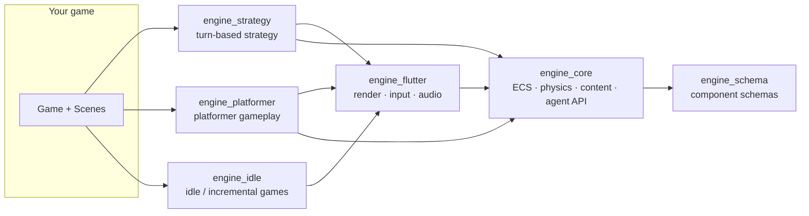

# Agentic Game Engine

A pure-Dart **2D game engine built for AI agents and humans to work on
together**. The world is plain JSON an agent can read and patch, content is
authored as data, and gameplay logic an agent writes runs behind a sandbox
that can't corrupt the simulation. Flutter is only the shell (rendering,
input, audio) for Android, iOS and the web.

## Pick your path

| I want to… | Start here |
|---|---|
| **Get a game running in 5 minutes** | [Getting started](getting-started.md) |
| **Build a platformer** | [Tutorial 1 — a tiny platformer](tutorials/01-hello-world.md) |
| **Build a turn-based strategy game** | [Tutorial 2 — turn-based strategy](tutorials/02-turn-based-strategy.md) |
| **Let an AI agent play or build the game** | [Tutorial 3 — an agent-driven game](tutorials/03-agent-driven-game.md) |
| Understand how the engine is put together | [Architecture](concepts/architecture.md) · [ECS](concepts/ecs.md) |
| Copy a focused snippet | [Examples](examples/README.md) |
| Look up a component's JSON shape | [Component reference](reference/components.md) |
| Look up an event, system order or command | [Cheat sheet](reference/cheatsheet.md) · [Events](reference/events.md) · [CLI](reference/cli.md) |
| Fix something that isn't working | [FAQ & troubleshooting](faq.md) |

## The four ideas that shape everything

1. **World state is data.** Every entity is a bag of registered components
   that serialize to JSON. `World.toJson()` is the read path and
   `World.applyPatch()` is the write path — see
   [content as data](concepts/content-as-data.md).
2. **Systems are small and ordered.** One system, one job, run in a
   registration order you can inspect (`world.systemOrder`) —
   see [the ECS](concepts/ecs.md).
3. **Agents propose, the engine disposes.** A `Behavior` reads a read-only
   `WorldView` and returns an `Action`; the engine applies it. In turn-based
   games, humans and AI alike go through `submitOrder` —
   see [the agent API](concepts/agent-api.md).
4. **Genre logic is separate from the core.** Platformer physics and
   strategy rules sit in their own packages on a one-way dependency chain, so
   a puzzle game never pays for gravity.

## Packages

| Package | What it gives you | Depends on |
|---|---|---|
| [`engine_core`](https://github.com/arashrasoulzadeh/agentic-game-engine/tree/main/packages/engine_core) | ECS, physics primitives, `TileMap`, content DSL, `WorldView`/`Behavior`, **turn clock, orders, grid navigation, combat, fog of war, selection** | `engine_schema` |
| [`engine_flutter`](https://github.com/arashrasoulzadeh/agentic-game-engine/tree/main/packages/engine_flutter) | `Game`/`Scene`, sprites, camera, lighting, input, audio, save/load, grid tap input | `engine_core` |
| [`engine_platformer`](https://github.com/arashrasoulzadeh/agentic-game-engine/tree/main/packages/engine_platformer) | Gravity, jump, tile collision, combat, patrol/follow AI, animation | core, flutter |
| [`engine_strategy`](https://github.com/arashrasoulzadeh/agentic-game-engine/tree/main/packages/engine_strategy) | One-call wiring for turn-based strategy, unit spawning | core, flutter |
| [`engine_cli`](https://github.com/arashrasoulzadeh/agentic-game-engine/tree/main/packages/engine_cli) | `game_agent create / upgrade / lint / pack-assets` | `engine_core` |
| [`engine_schema`](https://github.com/arashrasoulzadeh/agentic-game-engine/tree/main/packages/engine_schema) | Hand-written component schemas used by the CLI and studio | — |

## Reading this documentation

- **Concepts** explain *why* and *how it fits together*.
- **Tutorials** are linear: follow them in order and you end with a working game.
- **Examples** are standalone recipes, each verified by a test.
- **Reference** pages are lookup tables; the component page is generated from
  the source schemas.

!!! note "Code samples are tested"
    Samples in these pages are executed by tests in CI, so they cannot silently drift from the code:
    the tutorials (platformer, turn-based, agent) and the recipes in `examples/`
    (`packages/engine_platformer/test/doc_examples_*_test.dart`,
    `packages/engine_strategy/test/doc_examples_test.dart`,
    `packages/engine_core/test/agent_turn_based_test.dart`), and the concept pages for localization,
    dialogue, AI, ECS, effects, procedural generation, performance, settings, lighting and analytics
    (`packages/*/test/doc_examples_*_test.dart`). Not yet covered: the multiplayer tutorial, the
    older concept pages (architecture, rendering, real-time strategy; the networking page's calls - `ClientSession` clock sync, `nearbyInterest` - are exercised with the same API by `session_test.dart` and `interest_management_test.dart`) and the studio
    guide. If a sample drifts from the code, that is a bug - please open an issue or fix both.

## For AI agents reading this

- Every public symbol has a doc comment that explains *why*; `grep` the class
  under `packages/*/lib/src/` for the authoritative version.
- A component only participates in `toJson` / `applyPatch` / `Level.loadInto`
  once registered — see
  [FAQ: "my component isn't saved"](faq.md#my-component-isnt-saved-or-loaded).
- Drive gameplay through `Behavior` (real-time) or `submitOrder`
  (turn-based). Don't mutate stores from outside the system that owns the data.
- Start with [concepts/agent-api.md](concepts/agent-api.md) and
  [tutorial 3](tutorials/03-agent-driven-game.md).

## Project links

[Source on GitHub](https://github.com/arashrasoulzadeh/agentic-game-engine) ·
[Changelog](https://github.com/arashrasoulzadeh/agentic-game-engine/blob/main/CHANGELOG.md) ·
[Roadmap (TODO.md)](https://github.com/arashrasoulzadeh/agentic-game-engine/blob/main/TODO.md) ·
[Contributing](https://github.com/arashrasoulzadeh/agentic-game-engine/blob/main/CONTRIBUTING.md)
