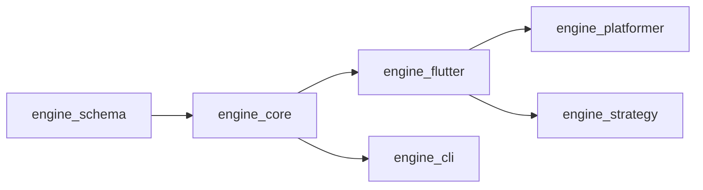
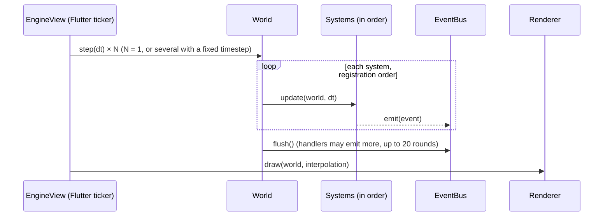
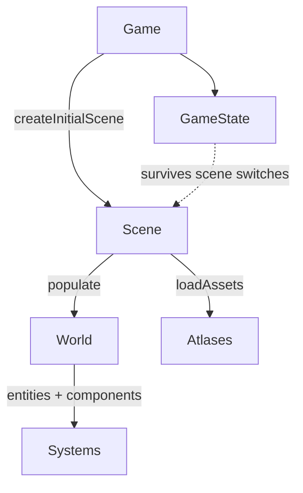
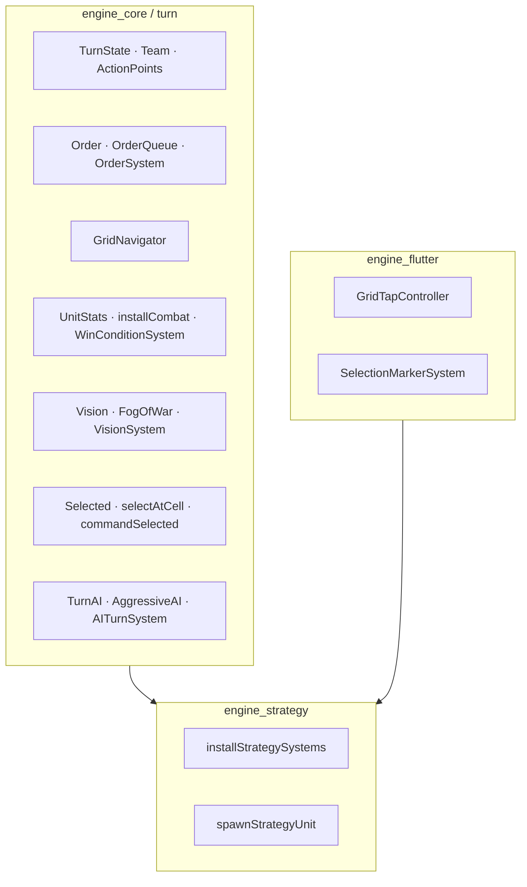

# Architecture

How the packages fit together and what happens on every frame.

## Package dependency chain

Dependencies run one way. A package may use anything to its left, never
anything to its right.

The rule that keeps this honest: **genre-general _data_ belongs in
`engine_core` even if only one genre uses it today; only genre-specific
_logic_ belongs further right.** `TileMap` is the cautionary example — it
looks platformer-specific, but the Flutter tile renderer needs the type, and
`engine_flutter` cannot depend on `engine_platformer`. The same reasoning
put the turn clock, orders and fog of war in `engine_core`
(`lib/src/turn/`) and only the assembly in `engine_strategy`.

## One frame

- By default the view calls `world.step(dt)` once per rendered frame with that
  frame's `dt`. Set `EngineView.fixedTimestepSeconds` (typically `1 / 60`) to
  decouple simulation from display rate: time accumulates, whole fixed steps
  run (capped at 5 per frame), and rendering interpolates `Position` between
  the last two states — so physics is identical on a 60 Hz phone and a 144 Hz
  monitor. Platformers should turn it on; turn-based games don't depend on `dt`
  at all.
- **Events are queued, then flushed once per step** after all systems ran.
  Handlers can emit new events; they are delivered in the same flush.
- Systems never call each other. They communicate through components and
  events, which is what makes each one safe to add, remove or replace.

## Scenes and state

A `Scene` owns a brand-new `World`. Switching scenes discards the world;
anything that must survive (score, unlocked rooms, a checkpoint) lives in
`GameState`.

## Where things live

| You need… | Look in |
|---|---|
| A new kind of data on entities | a component class + registration in the owning package's `register…Components` |
| A new rule that runs every tick | a `System`, added in the right place in the order |
| A reaction to something that happened | an `EventBus` handler (`world.events.on<T>`) |
| A decision made by AI or an LLM | a `Behavior` (real-time) / `TurnAI` (turn-based) |
| Content a designer or agent authors | JSON loaded by `Level.loadInto` |

## Why the turn-based layer is in the core

Pure rules in the core mean tests, replays and AI agents can run a whole game
**headless** — no Flutter, no screen. The Flutter layer only maps pixels to
cells and draws a marker.

## Further reading

- [ADRs](https://github.com/arashrasoulzadeh/agentic-game-engine/tree/main/docs/adr) — why schemas are hand-written, why commands live in core, why play-test is a separate process.
- [Root ARCHITECTURE.md](https://github.com/arashrasoulzadeh/agentic-game-engine/blob/main/ARCHITECTURE.md) — the short version.
