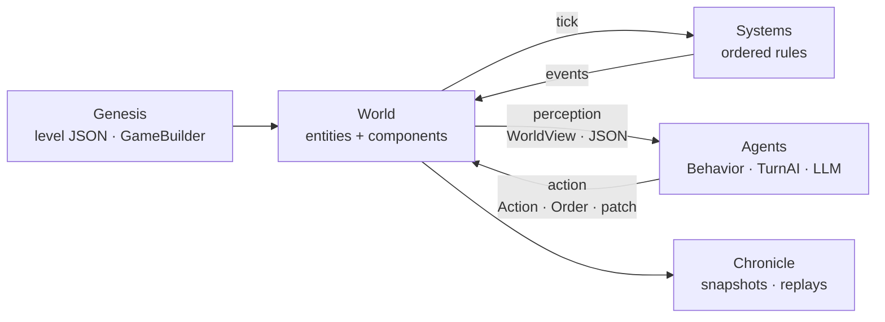

# The concept behind ZARVAN

Why the engine exists, what the name means, and the vocabulary the project
uses. Read this first if you want to know *what kind of engine this is*
before you learn *how it works* ([Architecture](architecture.md)).

## The meaning behind the name

**ZARVAN** (Persian: **زروان**, also written *Zurvan*) is an ancient Iranian
concept associated with **infinite time** and primordial existence. In that
worldview time is more than a measure of progression: it is the ground on
which worlds appear, evolve and change.

That is the idea the engine is built around:

- a world **begins** from an initial state;
- **time** and **rules** give that world its structure;
- independent **agents** live in it and act;
- every action **changes** the state of the world;
- the world can **evolve** over time.

!!! note "A modern reading, not a doctrine"
    The name is a creative, contemporary use of the concept. It does not
    claim to reconstruct a historical or religious teaching.

The tagline, **Where Worlds Begin.**, says the same thing in four words.

## What ZARVAN is

> ZARVAN is not only a game engine. It is infrastructure for building worlds
> that intelligent agents can live in, decide in, and change.

Concretely, ZARVAN is an **agent-native, simulation-first game engine built
with Dart**, aimed at 2D games. Five properties describe it, and each one maps
to something that exists in the code today:

| Property | What it means here | Where to read more |
|---|---|---|
| **Agent-Native** | An agent is a first-class user. It reads world state as JSON, changes it through patches, operations (CLI, MCP, REST) or orders, and drives an entity at runtime through a sandbox that cannot corrupt the simulation. | [The agent API](agent-api.md) · [Operations](../reference/operations.md) |
| **Simulation-First** | The simulation is the product; Flutter is only the shell for rendering, input and audio. The whole game can run headless (tests, replays, AI agents) with no screen. | [Architecture](architecture.md) |
| **Data-Driven** | World state and content are plain, serializable data: components registered by name, levels and idle games as JSON. | [Content as data](content-as-data.md) |
| **Deterministic** | Seeded randomness (`world.random`), a fixed timestep (`FixedStepper`), ordered systems and a serializable random stream, so the same inputs produce the same world. | [Writing games with less code](authoring.md) · [The ECS](ecs.md) |
| **Extensible** | New data is a component, new rules are a system, new decisions are a `Behavior`; genre logic lives in separate packages on a one-way dependency chain. | [Architecture](architecture.md) · [Examples](../examples/README.md) |

## The ZARVAN vocabulary

The project talks about worlds with a small shared vocabulary. This table maps
each word to what **actually exists** in the engine, so the words never promise
more than the code delivers.

| Word | Meaning | In the engine today |
|---|---|---|
| **World** | The simulation | `World`: entities, component stores, systems, events, random stream. |
| **Agent** | An independent decision-maker | Anything that decides through `Behavior` (real-time), `TurnAI` / `submitOrder` (turn-based), or the operations API. |
| **Tick** | One step of simulated time | `World.step(dt)`; with a fixed timestep, a fixed `dt`. |
| **State** | The condition of the world or an entity | Components, `World.toJson()`, `world.save()` / `world.load()`. |
| **Event** | Something that happened | `world.events` (`EventBus`), delivered once per step. |
| **Action** | What an agent does | `Action` returned by a `Behavior`; `Order` in turn-based games; patches and operations. |
| **Perception** | What an agent can see of the world | `WorldView` (read-only); fog of war in strategy games. |
| **Genesis** | Creating and initialising a world | `GameBuilder.create`, `Level.loadInto`, `Scene.populate`. |
| **Chronicle** | The history of a world | `ReplayRecorder` and canonical snapshots for replays and golden tests. |
| **Observer** | Something that watches the simulation | Read paths: `World.toJson()`, `WorldView`, the `world.describe` / `world.query` operations, the studio. |
| **Realm** | An independent space or territory | A `Scene` (a screen that owns a fresh `World`). |
| **Epoch** | A period of simulated time | Not an engine type. A `Round` in turn-based games is the closest existing unit. |

!!! info "Rule for naming things"
    A vocabulary word goes into code only when it matches a real technical
    responsibility, never just to make a class name sound better. "Epoch" is
    in this table as vocabulary, not as a class, for that reason.

## The shape of a ZARVAN world

Every world has a beginning. Every agent can act. Every action can change that
world's future, and because the whole loop is data, a person, a script and an
AI agent can all take part in it the same way.

## Who it is for

| You are… | Start here |
|---|---|
| A **game maker** using the engine through the CLI and Studio | [For game makers](../guides/for-users.md) |
| A **developer** writing Dart on top of the engine | [For developers](../guides/for-developers.md) |
| An **AI agent** (or building one) that reads and drives worlds | [For AI agents](../guides/for-ai-agents.md) |

## Principles that guide decisions

These come from the project's constraints and apply to every change:

1. **2D only.** No 3D, ever.
2. **Simulation logic never lives in the Flutter layer.** Flutter renders and handles input; rules live in `zarvan_core`.
3. **Agents propose, the engine disposes.** No agent has a path to corrupt state.
4. **Content is data.** If a designer or an agent can author it as JSON, it should be.
5. **Genre-general data in the core, genre-specific logic in its own package.**
6. **Nothing is documented that does not exist.** Samples are executed by tests in CI.
