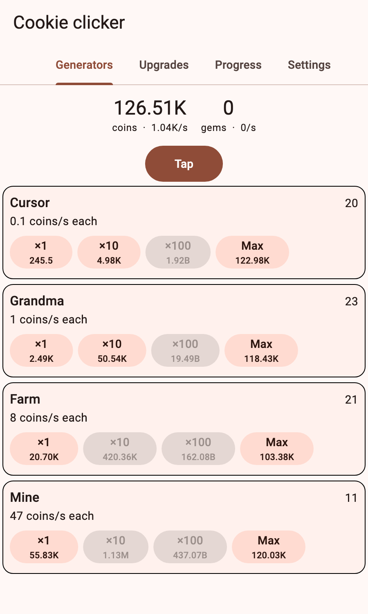

# Idle games

The idle / incremental genre layer is **shipped**: create a game with
`game_agent create my_game --template idle_game`, edit `assets/idle_game.json`,
and tune pacing with `game_agent idle simulate` / `idle validate`. Genre UI and
session code live in `engine_idle`; numbers, offline catch-up, economy rules and
the balance simulator live in `engine_core` (`engine_core_idle.dart`) so CLI and
agents can use them without Flutter.

Samples are executed by `packages/engine_core/test/doc_examples_idle_test.dart` and
`packages/engine_idle/test/doc_examples_test.dart`. The only open idle item in
[`TODO.md`](https://github.com/arashrasoulzadeh/agentic-game-engine/blob/main/TODO.md)
is a real-device performance bench (host baseline already exists).

## Creating a new idle game

```bash
game_agent create bakery --template idle_game
cd bakery && flutter run
```

Everything below is available as data and/or a widget. The template wires the
common path; optional blocks are noted.

| Subsystem | Where | In template? |
|---|---|---|
| Resources + generators + upgrades | `assets/idle_game.json` | yes |
| Cost curves (`geometric` / `linear` / `table`) | definition | yes (geometric) |
| Milestones on generators | definition | add when you want |
| Tech gates (`requires` on generators/upgrades) | definition + `TechState` in Dart | opt-in |
| Taps + timed boosts | `IdleController.tap` / `BoostSystem` | yes |
| Achievements | definition + `AchievementList` | yes |
| Prestige (single or layered `prestiges`) | definition + `PrestigePanel` | yes (single) |
| Challenges | definition + `ChallengePanel` | yes |
| Golden offers | `"golden"` + `GoldenEventSystem` + `GoldenOffer` | yes |
| Auto-buyer | `"autoBuyer"` + `AutoBuySystem` | opt-in (see below) |
| Offline catch-up + lifecycle | `IdleSession` + `IdleLifecycleHost` | yes (cold start + resume) |
| Durable save | web `BrowserSaveStore` / else `FileSaveStore` | yes |
| Export code / cloud hook | `SaveCodePanel` / `CloudSaveStore` | export yes; cloud is a contract |
| Stats | `StatsPanel` | yes |
| Number formats | `IdleSettingsPanel` / `formatBigNumber` | yes (not persisted yet) |
| Balance check | `game_agent idle simulate` / `idle.validate` | CLI / agent |
| Headless agent ops | `idle.*` on MCP/REST/CLI | yes |

To enable automation, add `"autoBuyer": { "intervalSeconds": 5, "maxPerRun": 10 }`
to the JSON and `world.addSystem(AutoBuySystem())` after `IdleSystem()`, then pass
`whileAway: runAutoBuyer` into `IdleSession` so it also buys offline.



## Numbers that do not overflow

An incremental game's totals outgrow a 64-bit integer within hours, and a `double` stops at 1e308. `BigNumber`
stores `mantissa * 10^exponent`, so the range is effectively unbounded and arithmetic never overflows:

```dart
final a = BigNumber.parse('1.5e300');
final b = BigNumber.from(2000);
a * b;                     // 3e303
a + BigNumber.one;         // unchanged: a term 17 orders of magnitude smaller is lost, like a double
a.pow(2); a.sqrt(); a.log10(); a.floor();
a > b;                     // total order, also across signs and zero
```

- It keeps about **15 significant digits**. That is the right trade for an idle game and the wrong one for money.
- Division by zero, `NaN` and infinity throw instead of spreading.
- JSON is the string `"1.5e300"`; it round-trips exactly.
- Compare results of long arithmetic chains with `approxEquals`, not `==`.

## Showing them

```dart
formatBigNumber(BigNumber.from(1234567));                                  // 1.23M
formatBigNumber(BigNumber.parse('4.5e12'), style: NumberStyle.scientific); // 4.50e12
formatBigNumber(BigNumber.from(999999));                                   // 1.00M  (rounding carries)
```

Styles: `suffix` (`K M B T Qa Qi Sx Sp Oc No Dc`, then scientific), `scientific`, `engineering`. Numbers below 1000 print
plainly. `decimals` and `decimalSeparator` are configurable.

## Resources: `BigTreasury`

`BigTreasury` is the idle-scale counterpart of the strategy `Treasury`: named resources and per-second income as
`BigNumber`s.

```dart
final wallet = BigTreasury(
  amounts: {'coins': BigNumber.from(10)},
  incomePerSecond: {'coins': BigNumber.from(5)},
);
wallet.accrue(1.0);                                   // income is rate x time
wallet.spend({'coins': BigNumber.from(50000)});       // true, or false and nothing taken
```

`accrue` is correct for any step size: one six-hour step gives the same result as 21,600 one-second steps, which
is what makes offline catch-up cheap. It is a registered component (`bigTreasury`), so it saves with the world.

## Offline progress

```dart
final summary = OfflineProgress.catchUp(
  wallet,
  lastActiveAt: leftAt,       // save this when the app pauses
  now: DateTime.now(),        // pass the clock in; the engine never reads it itself
);
summary.gained;               // {coins: 54000} for the "while you were away" screen
summary.credit.capped;        // true if the absence hit the cap
```

`OfflineConfig` sets the **cap** (default 8 hours), the **efficiency** (fraction of normal income earned away) and
the **minimum** absence (default 30 s; anything shorter earns and shows nothing). A clock that moved *backwards*
grants nothing. `OfflineProgress.untilCap` tells you when the cap will be reached, for a reminder.

!!! warning "Constant rates by default"
    Catch-up assumes your income rates stay the same while away. If your game has automation that spends money
    on upgrades (auto-buyers), pass `whileAway:` to `IdleSession` (or call `OfflineProgress.applyInSlices`): the
    absence is paid in slices (200 by default) and your callback runs between them to buy things and
    `recomputeIncome`, so each slice earns at the then-current rate. It is as accurate as the slice count.

## Describing a whole game as data

`engine_idle` loads an idle game from one JSON file: resources, **generators** (things you buy copies of that
make resources every second), **upgrades** (one-time multipliers), **achievements** and a **prestige** rule.

```json
{
  "resources": { "coins": { "start": "15" }, "gems": {} },
  "generators": [
    { "id": "cursor", "name": "Cursor",
      "cost": { "type": "geometric", "base": "15", "growth": 1.15 },
      "output": { "coins": "0.1" } }
  ],
  "upgrades": [ { "id": "x2", "target": "cursor", "multiplier": "2", "cost": { "coins": "100" } } ],
  "achievements": [ { "id": "rich", "stat": "lifetime:coins", "atLeast": "100000", "reward": "1.1" } ],
  "prestige": { "currency": "gems", "basedOn": "coins", "divisor": "1e6", "exponent": 0.5, "bonusPerUnit": 0.05 },
  "offline": { "capHours": 8, "efficiency": 0.5 }
}
```

```dart
final game = loadIdleDefinition(world, json);   // throws IdleDefinitionException listing every problem
world.addSystem(IdleSystem());                   // accrues income every step
buyGenerator(world, game.wallet, cursor);                  // ×1
buyGenerator(world, game.wallet, cursor, count: null);     // as many as affordable
```

`validateIdleDefinition(json)` returns the problems without throwing, each with its path
(`generators[1].cost.growth must be a number >= 1`), so an editor or an agent can fix them all at once. The full
example is `packages/engine_idle/example/cookie_clicker.json`.

- **Cost curves:** `geometric` (`base * growth^owned`, growth 1.07-1.15 is typical) and `linear`. Buying ×10 or
  "max" uses closed forms, so a budget of 1e200 is answered instantly.
- **Income** is `owned × output × (purchased upgrades targeting it) × (game-wide modifiers)`. Modifiers are named
  sources in `IdleModifiers` (prestige, achievements, boosts), so the player can be told why the number is what it is.
- **Prestige:** gain is `floor((earnedThisRun / divisor) ^ exponent)` of a permanent currency that adds
  `bonusPerUnit` to a game-wide multiplier per unit held. `performPrestige` resets resources, generators and
  (unless `keepUpgrades`) upgrades, and keeps the currency, lifetime stats and achievements.
- **Achievements** are goals over stats (`lifetime:`, `run:`, `owned:`, `prestiges`, `taps`, `seconds`) with an
  optional multiplier reward. Check them with `checkAchievements` after purchases and every few seconds.
- **Taps and boosts:** `tapEarn` and `activateBoost` (a timed multiplier; restarting the same boost refreshes it).

## Saving and returning

`IdleSession` saves the whole world with a version and a timestamp, migrates old saves, and pays offline progress
when the app returns:

```dart
final session = IdleSession(controller: controller, store: FileSaveStore(path),
    migrator: SaveMigrator(currentVersion: 2, migrations: {1: upgradeV1ToV2}),
    offline: game.offline);
final away = session.load();              // restore + offline catch-up; null on a first run
session.startAutosave();                  // every 30 s
```

Wrap the screen in `IdleLifecycleHost(session: session, onAway: showSummary, child: ...)` to save when the app is
backgrounded and settle the time away on return. A crash mid-write falls back to the previous save;
`exportCode()` / `importCode()` move a game between devices as a copyable `GSAVE1...` text; a save from a newer
game is refused with a readable message and left untouched.

## The screens

`IdleController` runs the clock (about ten UI updates a second) and is the one place the UI calls to buy, tap or
prestige. The ready-made widgets read from it: `ResourceHeader`, `GeneratorList` (×1 / ×10 / ×100 / Max, disabled
when unaffordable, lazily built so hundreds of rows stay smooth), `UpgradeList`, `OfflineSummaryDialog`
(with an optional "Double it" button for a rewarded ad: pass `onDouble`, then call `IdleSession.doubleOffline`),
`PrestigePanel` (previews the gain and asks before resetting), `ChallengePanel`, `AchievementList`,
`StatsPanel` (taps / prestiges / play time / earned), `GoldenOffer` and `IdleSettingsPanel`.
`controller.setStyle(NumberStyle.scientific)` switches every number at once (styles: `suffix`, `scientific`,
`engineering`, `grouped`).

## Storage choices

`FileSaveStore` (atomic, with a backup) on mobile and desktop; `BrowserSaveStore` (`localStorage`) on the web;
`MemorySaveStore` in tests. For several devices, implement `CloudSaveStore` over your platform's service and call
`IdleSession.syncCloud`: the save from the device that was active later wins, `resolve:` lets you ask the player,
and a pulled save pays no offline time. `SaveCodePanel` lets players move a game by copying text.

## More rules, all data

- **Milestones** on a generator (`"milestones": [{"owned": 25, "multiplier": "2"}]`) multiply its output; the row
  shows progress to the next.
- **Prestige** can keep chosen generators (`"keepGenerators": ["farm"]`) and upgrades (`keepUpgrades`).
- **Challenges** are restricted runs with a goal and a lasting reward: `"challenges": [{"id": "frugal", "rules": ["noUpgrades"],
  "goalStat": "run:coins", "goalAtLeast": "1e6", "reward": "3"}]`. Rules: `noUpgrades`, `noGenerator:<id>`,
  `incomeMultiplier:<factor>`. Starting one restarts the run (`startChallenge`), completing it (settled by
  `checkAchievements`) lifts the rules and multiplies income for good, and `ChallengePanel` lists, starts and abandons them.
- **Prestige layers:** use `"prestiges": [ {...}, {"id": "ascend", "currency": "stars", "basedOn": "gems", "divisor": "100",
  "resetsCurrencies": ["gems"]} ]` instead of a single `"prestige"`. A layer's gain counts toward the next layer's
  `basedOn`; a layer keeps the other layers' currencies unless it lists them in `resetsCurrencies`; each has its own
  income bonus (`prestige`, `prestige:<id>`). Call `performPrestige(world, wallet, 'ascend')` or show a
  `PrestigePanel(controller:, ruleId: 'ascend')` per layer.
- **Achievements** can count your own events: call `recordIdleEvent(world, wallet, 'dragon_slain')` and use
  `"stat": "event:dragon_slain"`.
- **Golden events** offer timed random boosts or payouts, reproducible from the seed: a `"golden": {"meanInterval": 90,
  "lifetime": 12, "rewards": [{"kind": "boost", "multiplier": "7", "seconds": 30}, {"kind": "payout", "seconds": 300}]}`
  block in the definition, `GoldenEventSystem(DeterministicRandom(seed))` in the world, and a `GoldenOffer(controller:)` widget
  (or `claimGolden` yourself).
- **Automation:** an `AutoBuyer` (in the definition as `"autoBuyer": {"intervalSeconds": 5, "maxPerRun": 10}`) buys the
  affordable purchase with the best payback on a timer; add `AutoBuySystem()` after `IdleSystem()`, flip `enabled` when
  the player unlocks it, and use `IdleSession(whileAway: ...)` with `runAutoBuyer` so it also works offline.
  `bestPurchase(world, wallet)` is the same recommendation as a function (for a "buy this next" hint).
- **Analytics** (`IdleAnalytics`) reports purchases, prestiges and returns through the consent-aware manager.

## Trust: the clock and the save

The engine makes a deliberate, simple choice: **a single-player idle game trusts the device**.

- *The clock.* Offline earnings come from the difference between two device times. `OfflineProgress` never
  grants negative time (the clock moved backwards) or more than the configured cap, so setting the clock
  forward can gain at most one cap's worth per return, which is the same as waiting. Time enters only through
  the `clock` you give `IdleSession`, so a game that needs more can pass a server-synchronised clock without
  touching the engine.
- *The save.* `SaveCodec` checksums detect damage, not editing: anyone can change a number and re-sign it. That
  is fine for a game with no shared state.
- *When it is not fine.* Leaderboards, competitive events or real-money purchases need the server to be the
  authority (server time, server-side validation of purchases and scores). That is outside the engine; keep
  the economy deterministic (it is) so a server can replay a claimed history and check it.

## Tuning without playing

`simulateIdle` (also `game_agent idle simulate` and the MCP/REST `idle.simulate` op) plays a definition with a
deterministic greedy strategy (buy the best payback, wait just long enough) and reports when income reaches each
power of ten, when achievements and prestiges happen, and why a design stalls. When `prestigeAt` is set it
prestiges **every** layer that meets the threshold (higher layers first, so a ready ascension is not starved by
cheaper first-layer prestiges); while a challenge is running it does not prestige (that would wipe the challenge's
run). Incomplete challenges are started in definition order as soon as none is active (`playChallenges: false`
skips them):

```bash
game_agent idle validate path/to/bakery/assets/idle_game.json
game_agent idle simulate path/to/bakery/assets/idle_game.json --days 3 --prestige-at 1.0
```

From an engine checkout you can also run
`dart run tool/simulate.dart example/cookie_clicker.json --days 3 --prestige-at 1.0` inside
`packages/engine_idle`. Use it to check that the early game is not a wall and that prestige pays at a sensible
time; it is a fair baseline, not an optimal player.
