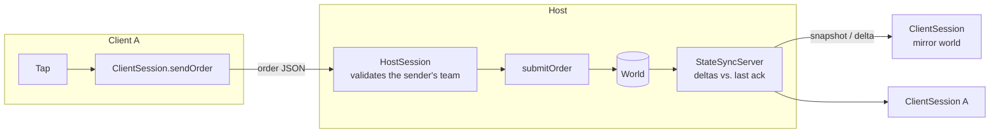

# Networking

How multiplayer works in this engine: an **authoritative host**, **orders** instead
of state from clients, and **replication** back. The code is in
`packages/engine_core/lib/src/net/` (transport-agnostic, pure Dart) and
`engine_core_io.dart` (sockets). A runnable walkthrough:
[Tutorial 4](../tutorials/04-multiplayer.md).



## The three rules

1. **Clients ask, the host decides.** A client never says "my unit is now at (3, 4)";
   it says "move this unit to (3, 4)". The host runs `submitOrder` against the real
   world, so a modified client can send only what the rules would accept from that
   team anyway.
2. **Teams belong to connections.** The host assigns a team at join time; every order
   is checked against the sender's team (`not your unit` otherwise).
3. **State flows one way.** The host replicates; clients overwrite their mirror.

## Layers

| Layer | Types | Job |
|---|---|---|
| Transport | `NetEndpoint`, `LoopbackLink`, `WebSocketEndpoint` | Move JSON maps. |
| Snapshots | `WorldSnapshot`, `WorldDelta` | A frozen world; the difference between two. |
| Replication | `StateSyncServer`, `StateSyncClient` | Send each client what changed since *its last acknowledged* tick. |
| Session | `HostSession`, `ClientSession` | Join/leave, team assignment, order validation, clock sync. |
| Prediction | `RollbackSession` | Run ahead on guessed input, rewind and replay on mismatch. |
| Fairness | `PositionHistory` | Rewind targets by latency for hit checks. |

### Why deltas are against the last *acknowledged* tick

A delta "since the previous packet" breaks the moment one packet is lost. A delta
against a tick the client confirmed is always applicable, at the cost of slightly
larger deltas while acks are in flight. The client keeps recent baselines, so it can
apply a delta made against an older one. The test suite runs this over a link that
drops 30% of packets, reorders and lags, and the client converges exactly.

## Transports

`NetEndpoint` is four members: `send`, `onMessage`, `onClose`, `close`. Implementations:

| | Where | Use |
|---|---|---|
| `LoopbackLink` | `engine_core` | Tests and replays: latency, jitter and loss with a seeded RNG, so a failure reproduces exactly. |
| `WebSocketEndpoint` | `engine_core_io.dart` | Real play on desktop/mobile/server. Bad frames are dropped, never thrown. |

`engine_core_io.dart` is separate from the main library on purpose, so
`engine_core` keeps compiling for the web. For a browser client, implement
`NetEndpoint` over `package:web_socket_channel`; `WebSocketEndpoint` (about 60 lines)
is the template.

## Protocol

All JSON. `host → client`: `welcome` (player, team, teams, tick, started), `start`,
`full`, `pong`, `rejected` (unit, reason), `snapshot`, `delta`. `client → host`:
`ping`, `order` (unit, order), `ack`.

Order refusal reasons: `no such unit`, `not your unit`, `malformed order`,
`order not allowed now` (wrong turn, game over).

## Measuring latency

```dart
final client = ClientSession(world: w, endpoint: e, clock: () => stopwatch.elapsedMilliseconds);
client.ping();                         // later…
client.rttMs;                          // round trip of the last ping
client.estimatedServerTick(1 / 20);    // host tick now ≈ last pong + elapsed + rtt/2
```

The clock is a function so it is read at the instant a pong *arrives* (only the
session knows that), and injected so tests are deterministic.

## Prediction and rollback

For real-time games where waiting a round trip for every order feels bad, run the
simulation locally too and reconcile with `RollbackSession`: it predicts remote input
as "same as last time", and when the real input arrives and differs, rewinds to that
tick and replays. It requires a **deterministic** simulation — see the
[iteration-order trap](realtime-strategy.md#determinism-the-iteration-order-trap).
`correctState` accepts an authoritative snapshot from the host as the safety net.

## Lag compensation

A shooter aims at the world as they *saw* it, roughly `latency + interpolation delay`
ago. Checking the shot against the host's current positions makes players miss
targets that were under the crosshair. `PositionHistory` records positions per tick;
`rewind(PositionHistory.rewindTick(...))` gives the shooter's view for the hit test.

## Interest management

By default every client gets the whole world. Give `addClient` an `interest` rule to send a
client only what it should see — less bandwidth, and a client cannot read what it never
receives (units in fog, the far side of a big map):

```dart
sync.addClient(
  playerId,
  send,
  interest: nearbyInterest(
    center: () => cameraOf(playerId),     // (x: .., y: ..) or null to see everything
    radius: 800,
    always: () => ownUnitIds(playerId),   // never hide a player's own things
  ),
);
```

The rule is a factory, re-evaluated every broadcast, so the view follows the camera. Entities
with no `position` (a treasury, match state) are always sent. Write your own
`InterestFilter` — `(id, components) => bool` — for other rules, e.g. "units my team can see".

A delta for such a client is taken against **what that client was actually sent**, not the
whole world, so an entity that leaves its view is removed on its side instead of freezing there
as a ghost. The server keeps one such record per filtered client; unfiltered clients are
unchanged and share one.

## Limits (be honest with yourself)

- **No NAT traversal or matchmaking.** A host must be reachable (LAN, port-forward,
  or a server).
- **No encryption or authentication.** Use `wss://` behind a reverse proxy; the host
  trusts a connection to be one player.
- **Full-world snapshots by default.** Fine for hundreds of entities; use the interest rules
  above for larger worlds.
- **Reliable ordering** is assumed from WebSockets (TCP). Over UDP-like transports
  the sync layer tolerates loss and reordering, but orders need their own
  acknowledgement.

## Browser clients

A Flutter web client cannot use `dart:io`. Import `package:engine_core/engine_core_web.dart` and connect with
`connectBrowserWebSocket('wss://game.example.com/play')`; it returns the same `NetEndpoint` the rest of the
session code uses, so `ClientSession(world: world, endpoint: endpoint)` is unchanged. Browsers cannot listen, so
the host stays a `dart:io` server (`WebSocketListener`). Serve the page over https and connect with `wss://`
(browsers block plain `ws://` from an https page), and authenticate in the URL or in a first message your host
checks before accepting orders.

## A ready-made client screen

`OnlineStrategyView` (in `engine_strategy`) does the client side for a grid-based game: pass it the open endpoint,
your atlas registry and the grid size, and it mirrors the host, draws it, lets the player tap a unit and then a
cell (move) or an enemy (attack), and sends those as orders. Nothing is applied locally; the result arrives in the
host's state, and a refused order reaches `onRejected`.

## Who may join

By default any connection takes a free team. To require credentials, give the host a check:

```dart
final host = HostSession(
  world: world,
  teams: ['red', 'blue'],
  authenticate: (token, name) => tokens.isValid(token),   // may be async
);
```

A connection then gets nothing (no team, no state) until its first message, `hello` with the token, passes. A
refusal sends `denied` and closes; one that never says hello is dropped after `authTimeoutTicks` calls to
`afterStep`. The client passes `ClientSession(..., token: ..., name: ...)` and sees `denied`. This is a gate, not
encryption: serve over `wss://` so the token cannot be read on the way. Orders are validated per team either way.

## UDP

For lower latency, `UdpListener.bind(host.accept)` and `connectUdp('host', port)` (both in `engine_core_io.dart`)
give the same `NetEndpoint` over UDP datagrams. A lost packet is not waited for; the sync layer repairs it with the
next snapshot or delta. UDP has no connection, so the first packet introduces a client, `close()` says goodbye at
once, keep-alives hold an idle peer open and a silent one is dropped after `idleTimeout` (10 s by default).

Keep messages small on the internet: past about 1,400 bytes a datagram is split in transit and losing any piece loses
it all (the hard limit is `udpMaxMessageBytes`, 60,000; larger messages are counted in `oversized` and not sent).
A big first snapshot is therefore better sent over a WebSocket. Browsers cannot send UDP at all.

## Finding a game: the lobby

`LobbyServer` is a room list. Run one anywhere reachable, on the same listeners as a game host
(`WebSocketListener.bind(lobby.accept)`). A game host announces itself, keeps the connection open, and updates its
player count; a player lists open rooms and connects to a room's `url` with the normal client:

```text
host -> lobby    {"type":"create","name":"Duel","url":"wss://play.example.com:4040","maxPlayers":2}
lobby -> host    {"type":"created","id":7}
host -> lobby    {"type":"update","id":7,"players":1}
player -> lobby  {"type":"list"}
lobby -> player  {"type":"rooms","rooms":[{"id":7,"name":"Duel","url":"wss://...","maxPlayers":2,"players":1}]}
```

Full rooms are hidden, a room vanishes when its host's connection ends (so a crashed host never lingers), only the
creator can change or close it, and sizes and counts are capped. The lobby does not relay traffic or get through
NAT: hosts must be reachable (a server or a forwarded port), and it has no accounts. Protect it with the same
`wss://` and, if needed, your own token check in front of `accept`.
