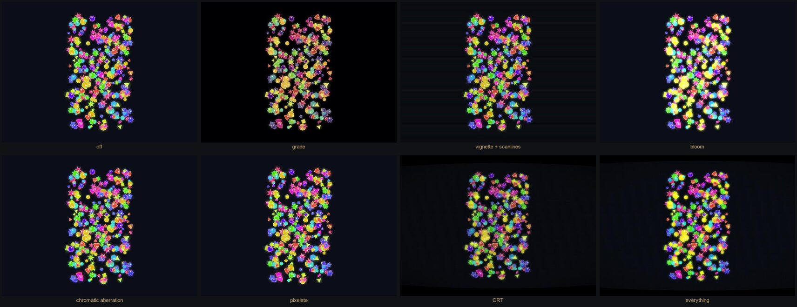
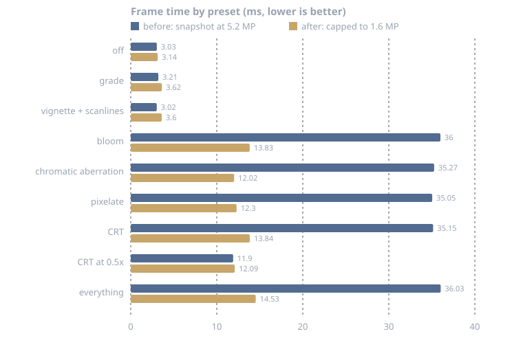
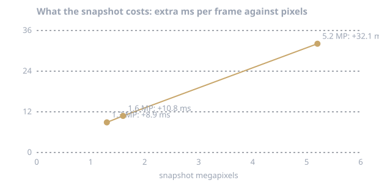
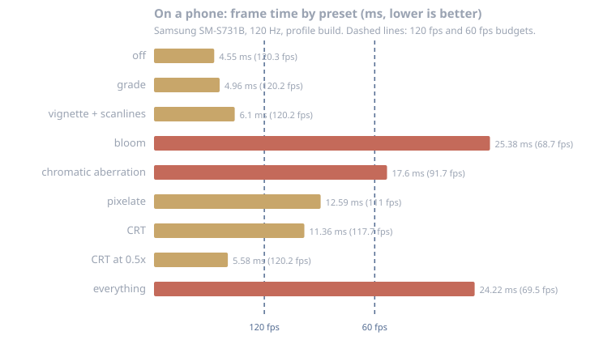

# Post-processing and screen effects

Full-screen looks for a finished frame: colour grading, vignette, scanlines, bloom, chromatic aberration, pixelate and
a CRT. They live in `zarvan_flutter` and are all optional; a game that uses none of them pays nothing.



*The same 300 random procedural sprites and seed in every cell, rendered in Chrome with the demo described
[below](#try-it-yourself-random-assets-in-the-browser).*

## Two layers, one choice

| | `PostProcessed` | `ShaderPostProcessed` |
|---|---|---|
| Effects | `ColorGrade`, `Vignette`, `Scanlines` | bloom, chromatic aberration, pixelate, CRT curvature, phosphor mask, vignette, grain, one pass |
| How | A colour filter plus painted overlays on top of the child | The child is snapshotted each frame and redrawn through one fragment shader |
| Cost | About nothing (see [measurements](#measurements)) | One snapshot per frame, **independent of how many effects are on** |
| Latency | None | One frame behind |
| Works on | Everywhere | Every backend (it does not need `ImageFilter.shader`) |
| Switch it on | Wrap a widget: `PostProcessed(effects: [...], child: ...)` | `game.postFx.value = ShaderPostFx.crt()`, or wrap a widget |

Use `PostProcessed` for grade, vignette and scanlines, and `ShaderPostFx` for everything that needs a shader. Both can
be on at once; `runGame` wires `Game.postFx` for you.

## Effects reference

| Effect | Where | Parameters |
|---|---|---|
| Brightness, contrast, saturation, tint | `ColorGrade` | 1 is neutral; several grades compose into one filter layer |
| Edge darkening | `Vignette`, or `ShaderPostFx.vignette` | strength and radius, or strength 0..1 |
| CRT lines | `Scanlines`, or `ShaderPostFx.scanlines` | opacity and spacing |
| Glow on bright areas | `ShaderPostFx.bloom` | `bloom`, `bloomThreshold` (luminance 0..1), `bloomRadius` (px) |
| Colour fringing | `ShaderPostFx.chromaticAberration` | pixels of red/blue split at the screen edge |
| Big pixels | `ShaderPostFx.pixelSize` | pixels per big pixel; 0 is off |
| CRT screen | `ShaderPostFx.curvature`, `phosphorMask`, `scanlines` | 0 flat; presets `ShaderPostFx.crt()` and `bloomOnly()` |
| Film grain | `ShaderPostFx.grain` | animated noise amplitude |

A `ShaderPostFx` with every field at its default is the identity: `ShaderPostProcessed` then shows its child
unchanged and never takes a snapshot.

## Measurements

The cost of an effect is not the effect. It is the snapshot.

!!! warning "Web and one Android phone"
    The first set of figures was measured in **Chrome on a Mac, on the web**. A second set comes from **one Android phone**
    (Samsung SM-S731B, a native profile build). The two disagree about *why* effects cost what they do, so read both. Other
    devices were not measured; a different GPU can change the ratios again, so measure on the devices you ship to.

**Web setup.** Chrome on an Apple M1 Pro (Metal), a 1512x862 window at 2x device pixel ratio (3024x1724 px), a
`flutter build web --profile` build, 400 random sprites. Each preset ran for 4 s after a 1.5 s warm-up; the figures are
the average of `FrameTiming.totalSpan`. Raw numbers: [`docs/data/postfx-benchmark.json`](../data/postfx-benchmark.json).



| Preset | Before (5.2 MP snapshot) | After (capped to 1.6 MP) | p95 after |
|---|---:|---:|---:|
| off | 3.0 ms | 3.1 ms | 4.5 ms |
| grade | 3.2 ms | 3.6 ms | 4.9 ms |
| vignette + scanlines | 3.0 ms | 3.6 ms | 5.0 ms |
| bloom | 36.0 ms | 13.8 ms | 15.1 ms |
| chromatic aberration | 35.3 ms | 12.0 ms | 12.9 ms |
| pixelate | 35.1 ms | 12.3 ms | 13.6 ms |
| CRT | 35.2 ms | 13.8 ms | 15.9 ms |
| CRT at 0.5x | 11.9 ms | 12.1 ms | 14.0 ms |
| everything on | 36.0 ms | 14.5 ms | 17.4 ms |

What the numbers say:

- **Grade, vignette and scanlines are free.** Within a few tenths of a millisecond of no effect at all.
- **On the web, every shader preset costs the same.** Bloom (a 16-tap blur), a three-tap chromatic split and a single-tap pixelate
  all land within about 1.5 ms of each other, and "everything on" is only 1 to 2 ms above the cheapest. On that desktop
  GPU the fragment shader is not the bottleneck. **This does not hold on a phone**, see below.
- **The snapshot is the cost, and it grows with pixels.**



  Roughly 6 ms per megapixel here. On a 2x display a full-resolution snapshot is 5.2 MP, about 32 ms: more than a
  frame at 30 fps. That is why `ShaderPostProcessed` now caps the snapshot to `maxPixels` (1.6 MP by default), which
  cut the shader presets from about 35 ms to about 13 ms. The cap only ever lowers the resolution: a screen already
  under budget is untouched, and `maxPixels: 0` turns the cap off.
- **`scale` and the cap do the same job.** `scale: 0.5` at 2x is already 1.3 MP, so it measured the same as the cap.

**Read the web figures as relative.** One machine, a window the browser ran at about 30 Hz (so frame time is reported, not fps),
two runs on a quiet machine. Runs taken while the machine was busy swung from 3 ms to 190 ms for the same preset and
were thrown away. The Flutter web raster time is not reported reliably, so
the figures are whole-frame spans.

### On a phone (Android)

**Setup.** Samsung SM-S731B, Android 17, a 120 Hz display at 1080x2340 px (device pixel ratio 2.81, about 2.5 MP),
`flutter run --profile` (native, Impeller), the same 400 random sprites. The snapshot is capped to 1.6 MP by default, so
it was rendered below native resolution. Raw numbers are in the JSON file above.



| Preset | Frame time | fps | p95 | Over baseline |
|---|---:|---:|---:|---:|
| off | 4.6 ms | 120 | 5.5 ms | |
| grade | 5.0 ms | 120 | 5.9 ms | +0.4 ms |
| vignette + scanlines | 6.1 ms | 120 | 7.1 ms | +1.6 ms |
| bloom | 25.4 ms | 69 | 35.1 ms | +20.8 ms |
| chromatic aberration | 17.6 ms | 92 | 24.6 ms | +13.0 ms |
| pixelate | 12.6 ms | 111 | 19.5 ms | +8.0 ms |
| CRT | 11.4 ms | 118 | 17.3 ms | +6.8 ms |
| CRT at 0.5x | 5.6 ms | 120 | 7.4 ms | +1.0 ms |
| everything on | 24.2 ms | 70 | 30.1 ms | +19.7 ms |

What the phone says:

- **Here the effect matters.** Bloom (a 16-tap blur) is the most expensive at about 21 ms over baseline, chromatic
  aberration costs 13 ms, a CRT about 7. The ordering follows the work the shader does, not the snapshot, which is the
  opposite of the web result.
- **Resolution is the lever.** The CRT at half resolution costs 1 ms and holds 120 fps; at the default cap it costs
  7 ms and still holds about 118. If you want bloom on a phone, run it at a lower `scale` (try `0.5`).
- **The cheap passes cost 0.4 and 1.6 ms.** Fine at 120 Hz and free at 60 Hz. Scanlines cost the most of them because
  they paint many thin rects; a handful of wider lines is cheaper.
- **Frame budgets.** 120 fps is 8.3 ms and 60 fps is 16.7 ms. Bloom and the full stack at the default cap miss 60 fps on
  this phone; the CRT, pixelate and the cheap passes fit.
- **Heat dominates.** The table above is the first run, with the phone at 31 °C on battery. Later runs, with the phone
  at 38 to 41 °C and charging over USB, ran the same presets two to three times slower (the CRT went from 11 ms to
  20 to 31 ms) and identical runs differed by up to 25%. When the phone was hot, shrinking the snapshot from 2.5 MP to
  0.5 MP changed the CRT by only 31.8 to 26.3 ms. Benchmark on a cool phone, unplugged, with a pause between runs, and
  compare variants interleaved in one run rather than across runs.
- **What did not help.** Splitting the shader so non-bloom presets skip the bloom code made no difference when the two
  were interleaved in the same run (chromatic 37.1 vs 28.2 ms, pixelate 27.4 vs 23.7, CRT 20.1 vs 20.0), so the combined
  shader stayed.
- One device, one run each. Another GPU may order these differently.

**Two traps found while measuring**

- A hidden or backgrounded browser tab runs `requestAnimationFrame` at about 1 Hz or not at all, so benchmarks from a
  hidden pane show every preset as unusably slow. Measure in a visible, focused window.
- After rebuilding a Flutter web app, the old build can keep loading from its service worker. Unregister it (or use a
  fresh profile) before trusting a before/after comparison; ours first reported no change from a fix that worked.

## Tuning

| Goal | Do |
|---|---|
| Cheapest possible look | `PostProcessed` only: grade, vignette, scanlines |
| A CRT on a phone | The default cap held 118 fps on the test phone; lower `scale` if your target is slower |
| Bloom on a phone | It was the costliest effect (about 21 ms over baseline); use `scale: 0.5` or skip it on mid-range devices |
| Crisp bloom on a desktop | `maxPixels: 0` (no cap) and accept the snapshot cost, or `scale: 1` with a lower DPR |
| Effects only sometimes | Set `game.postFx.value` back to `const ShaderPostFx()`: the identity takes no snapshot |
| Settings toggle | Store a bool and map it to `ShaderPostFx.crt()` or the identity |

## Recipes

**A hit flash.** Fringe and darken the edges for a moment, then clear it:

```dart
Future<void> flashOnHit(Game game) async {
  game.postFx.value = const ShaderPostFx(chromaticAberration: 6, vignette: 0.55);
  await Future<void>.delayed(const Duration(milliseconds: 120));
  game.postFx.value = const ShaderPostFx(); // identity: no snapshot, no cost
}
```

**Low health.** Let the vignette grow as health falls (call it from a system or a listener, not every frame if health
did not change):

```dart
void showDanger(Game game, double health01) {
  final danger = (1 - health01).clamp(0.0, 1.0);
  game.postFx.value = danger < 0.3
      ? const ShaderPostFx()
      : ShaderPostFx(vignette: 0.15 + danger * 0.55, grain: danger * 0.05);
}
```

**Underwater or night.** A grade needs no shader at all:

```dart
PostProcessed(
  effects: const [
    ColorGrade(saturation: 0.7, brightness: 0.85, tint: Color(0xFF8CC8FF)),
    Vignette(strength: 0.5),
  ],
  child: GameRunner(game: game),
)
```

**A retro-mode setting.** One flag, two looks:

```dart
void applyRetro(Game game, bool on) =>
    game.postFx.value = on ? const ShaderPostFx.crt() : const ShaderPostFx();
```

**A per-scene look.** Set `game.postFx.value` when a scene starts (a boss arena in CRT green, a menu with none) and set
it back when you leave. Scenes never touch the renderer; they only set data.

**Respect accessibility.** Grain, scanlines and chromatic aberration are motion and contrast noise; skip them when the
player turned on reduced motion or high contrast (see [Settings](settings.md)).

## Try it yourself: random assets in the browser

The screenshots and the numbers on this page come from a small local app (kept out of the repository, like every sample
app) that draws random procedural sprites, so there is nothing to download. Its core, about 60 lines:

```dart
class DemoScene extends Scene {
  @override
  Future<AtlasRegistry> loadAssets() async {
    final r = math.Random(7); // change the seed for a new set of assets
    final rec = ui.PictureRecorder();
    final c = Canvas(rec);
    final rects = <String, Rect>{};
    for (var i = 0; i < 16; i++) {
      final cx = (i % 4) * 32.0 + 16, cy = (i ~/ 4) * 32.0 + 16;
      rects['r$i'] = Rect.fromLTWH((i % 4) * 32.0, (i ~/ 4) * 32.0, 32, 32);
      final hue = r.nextDouble() * 360;
      final base = HSVColor.fromAHSV(1, hue, .8, .9).toColor();
      final spikes = 3 + r.nextInt(5);
      final path = Path();
      for (var k = 0; k < spikes * 2; k++) {
        final a = k * math.pi / spikes, rad = k.isEven ? 12.0 : 6.0;
        final p = Offset(cx + math.cos(a) * rad, cy + math.sin(a) * rad);
        k == 0 ? path.moveTo(p.dx, p.dy) : path.lineTo(p.dx, p.dy);
      }
      c.drawPath(path..close(), Paint()..color = base);
    }
    final img = await rec.endRecording().toImage(128, 128);
    return AtlasRegistry()..register('rnd', SpriteAtlas(img, rects));
  }

  @override
  Future<void> populate(World world, SceneController scenes, GameState state) async {
    world.addSystem(MovementSystem());
    final r = math.Random(7);
    for (var i = 0; i < 400; i++) {
      final e = world.spawn();
      world.componentsOf<Position>().set(e, Position(r.nextDouble() * 360, r.nextDouble() * 640));
      world.componentsOf<Velocity>().set(e, Velocity((r.nextDouble() - .5) * 60, (r.nextDouble() - .5) * 60));
      world.componentsOf<Sprite>().set(e, Sprite('rnd', 'r${r.nextInt(16)}', rotation: r.nextDouble() * 6.28));
    }
  }
}
```

Wrap it the way the benchmark did, then switch `fx` from a chip row or a query parameter:

```dart
final fx = ValueNotifier<ShaderPostFx>(const ShaderPostFx.crt());
runApp(MaterialApp(
  home: ValueListenableBuilder<ShaderPostFx>(
    valueListenable: fx,
    builder: (_, value, _) => ShaderPostProcessed(
      fx: value,
      child: GameRunner(game: DemoGame()),
    ),
  ),
));
```

**To measure on your own device**, add a timings callback and average it over a few seconds per preset:

```dart
SchedulerBinding.instance.addTimingsCallback((timings) {
  for (final t in timings) {
    samples.add(t.totalSpan.inMicroseconds / 1000); // ms
  }
});
```

Build with `flutter build web --profile` (or run a profile build on the phone), keep the window visible and focused,
and throw away any run where the no-effect preset is not steady.

## Limits and what is next

- **The snapshot is the whole cost.** On Impeller platforms (iOS, Android) `ImageFilter.shader` could run the same
  shader with no snapshot at all; that path is not built yet. See [TODO](https://github.com/arashrasoulzadeh/zarvan/blob/main/TODO.md).
- **One frame behind.** The overlay shows the previous frame's snapshot. For a CRT or bloom this is invisible; do not
  use it for a hit flash that must land on the exact frame (use `PostProcessed`, or accept 16 ms).
- **No depth of field, motion blur or distortion yet** (shockwaves, heat haze).
- **Web.** Measured and tested on the CanvasKit renderer only; the older HTML renderer has no fragment shaders.
- **One phone only.** See the warning above.

See also: [Rendering](rendering.md), [Settings and accessibility](settings.md), [Performance](performance.md).
