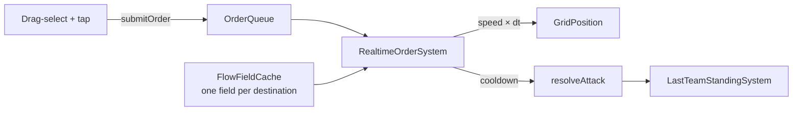

# Real-time strategy

The same orders, selection, navigation and fog as [turn-based strategy](turn-based-strategy.md),
driven by **time** instead of turns. A world with no `TurnState` is real-time.



## Quick start

```dart
final install = installRealtimeStrategySystems(
  world,
  navigator: GridNavigator(cols: 40, rows: 40, terrainCost: (c, r) => 1),
  cellSize: 32,
);

spawnStrategyUnit(world, team: 'red', col: 2, row: 5, cellSize: 32,
    attack: 4, realtime: RealtimeStats(speed: 4, attackInterval: 0.8));

final taps = GridTapController(32, localTeam: 'red');   // in Scene.handleTap
taps.handleTap(world, worldPosition);
taps.handleDrag(world, dragStart, dragEnd);             // box select

// later: install.matchRule.winner  → 'red' | null
```

!!! warning "Use a fixed timestep"
    Set `GameConfig.fixedTimestepSeconds` (for example `1 / 20` in
    `game_config.json`). The systems are deterministic **for identical `dt`**,
    which replays, rollback and lockstep multiplayer need; raw frame times break
    that. Turn-based games don't care.

## What's different from turn-based

| | Turn-based | Real-time |
|---|---|---|
| Budget | `ActionPoints` per turn | `RealtimeStats.speed` (cells/s), `attackInterval` (s) |
| Clock | `TurnState`, `endTurn` | none — `world.step(fixedDt)` |
| Who can be ordered | the active team | any unit with a `Team`; the *caller* decides which (pass `localTeam`) |
| Movement | `OrderSystem`, one `findPath` per step | `RealtimeOrderSystem`, shared [flow fields](#flow-fields) |
| Combat | on an `AttackResolvedEvent` | applied directly, on a per-unit cooldown |
| Winner | `WinConditionSystem` + `TurnState.winner` | `LastTeamStandingSystem.winner` |
| Orders | move, attack, defend, overwatch | move, attack |

## Flow fields

`GridNavigator.findPath` runs one search per unit. Send a hundred units to one
spot and that is a hundred searches. A **flow field** is one pass over the grid
that records every cell's cost to the goal; every unit then just steps downhill.

```dart
final field = FlowField.build(navigator, goalCol, goalRow);
field.costAt(col, row);                       // cost to the goal, or FlowField.unreachable
field.nextStep(position, blocked: isOccupied); // best strictly-closer free neighbour, or null
```

`FlowFieldCache` shares fields per destination (LRU, default 32). Call
`fields.invalidate()` when terrain changes. Fields use the navigator's own
rules (terrain costs, diagonals, no corner cutting), so units take the routes
`findPath` would.

## Combat behaviour

- An `AttackOrder` makes the unit chase its target (re-reading the target's cell
  as it moves) and hit it once per `attackInterval` until it dies.
- With `autoEngage` (default on), a unit that is **idle or boxed in** hits the
  nearest visible enemy within reach by itself. Without it, a column of units
  jammed against each other — each ordered at a distant target — just stand there
  being shot.
- Ranged units use `AttackProfile.range`; fog applies (`canSee`) exactly as in
  turn-based play.

## Determinism: the iteration-order trap

Rollback and replay rebuild a world from a snapshot — same data, but each
`ComponentStore`'s *internal order* depends on its add/remove history, so it
differs. Any system that settles a tie or a contested cell by "whoever the store
lists first" then plays out differently, and the two simulations silently
diverge.

!!! tip "The rule"
    In a deterministic system, iterate **in entity-id order** and break ties by
    id, never by store order. `RealtimeOrderSystem`, `OrderSystem` and the AIs do;
    `restore_determinism_test.dart` fails if they stop.

This was found by a test that snapshots a battle mid-way, restores it into a fresh
world and replays — the replay disagreed until the systems sorted by id.

## Lockstep multiplayer

The pieces fit together with the networking foundation in
`engine_core/lib/src/net/` (`WorldSnapshot`, `RollbackSession`, `StateSyncServer`):
send only *orders* (tiny JSON) with the tick they apply on, run every client at the
same fixed `dt`, and use `WorldSnapshot` for late joiners and desync recovery.
A real socket transport is still to be written (see the roadmap).

## Not built yet

Formations, unit collision radii beyond one-unit-per-cell, production and
resource economy, and a skirmish AI for real time.
