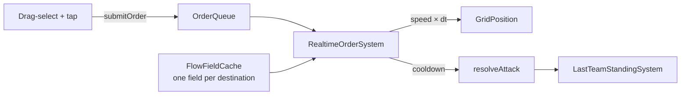

# Real-time strategy

The same orders, selection, navigation and fog as [turn-based strategy](turn-based-strategy.md),
driven by **time** instead of turns. A world with no `TurnState` is real-time.



## Quick start

```dart
final install = installRealtimeStrategySystems(
  world,
  navigator: GridNavigator(cols: 40, rows: 40, terrainCost: (c, r) => 1),
  cellSize: 32,
);

spawnStrategyUnit(world, team: 'red', col: 2, row: 5, cellSize: 32,
    attack: 4, realtime: RealtimeStats(speed: 4, attackInterval: 0.8));

final taps = GridTapController(32, localTeam: 'red');   // in Scene.handleTap
taps.handleTap(world, worldPosition);
taps.handleDrag(world, dragStart, dragEnd);             // box select

// later: install.matchRule.winner  → 'red' | null
```

!!! warning "Use a fixed timestep"
    Set `GameConfig.fixedTimestepSeconds` (for example `1 / 20` in
    `game_config.json`). The systems are deterministic **for identical `dt`**,
    which replays, rollback and lockstep multiplayer need; raw frame times break
    that. Turn-based games don't care.

## What's different from turn-based

| | Turn-based | Real-time |
|---|---|---|
| Budget | `ActionPoints` per turn | `RealtimeStats.speed` (cells/s), `attackInterval` (s) |
| Clock | `TurnState`, `endTurn` | none — `world.step(fixedDt)` |
| Who can be ordered | the active team | any unit with a `Team`; the *caller* decides which (pass `localTeam`) |
| Movement | `OrderSystem`, one `findPath` per step | `RealtimeOrderSystem`, shared [flow fields](#flow-fields) |
| Combat | on an `AttackResolvedEvent` | applied directly, on a per-unit cooldown |
| Winner | `WinConditionSystem` + `TurnState.winner` | `LastTeamStandingSystem.winner` |
| Orders | move, attack, defend, overwatch | move, attack |

## Flow fields

`GridNavigator.findPath` runs one search per unit. Send a hundred units to one
spot and that is a hundred searches. A **flow field** is one pass over the grid
that records every cell's cost to the goal; every unit then just steps downhill.

```dart
final field = FlowField.build(navigator, goalCol, goalRow);
field.costAt(col, row);                       // cost to the goal, or FlowField.unreachable
field.nextStep(position, blocked: isOccupied); // best strictly-closer free neighbour, or null
```

`FlowFieldCache` shares fields per destination (LRU, default 32). Call
`fields.invalidate()` when terrain changes. Fields use the navigator's own
rules (terrain costs, diagonals, no corner cutting), so units take the routes
`findPath` would.

## Combat behaviour

- An `AttackOrder` makes the unit chase its target (re-reading the target's cell
  as it moves) and hit it once per `attackInterval` until it dies.
- With `autoEngage` (default on), a unit that is **idle or boxed in** hits the
  nearest visible enemy within reach by itself. Without it, a column of units
  jammed against each other — each ordered at a distant target — just stand there
  being shot.
- Ranged units use `AttackProfile.range`; fog applies (`canSee`) exactly as in
  turn-based play.

## Determinism: the iteration-order trap

Rollback and replay rebuild a world from a snapshot — same data, but each
`ComponentStore`'s *internal order* depends on its add/remove history, so it
differs. Any system that settles a tie or a contested cell by "whoever the store
lists first" then plays out differently, and the two simulations silently
diverge.

!!! tip "The rule"
    In a deterministic system, iterate **in entity-id order** and break ties by
    id, never by store order. `RealtimeOrderSystem`, `OrderSystem` and the AIs do;
    `restore_determinism_test.dart` fails if they stop.

This was found by a test that snapshots a battle mid-way, restores it into a fresh
world and replays — the replay disagreed until the systems sorted by id.

## Lockstep multiplayer

The pieces fit together with the networking foundation in
`engine_core/lib/src/net/` (`WorldSnapshot`, `RollbackSession`, `StateSyncServer`):
send only *orders* (tiny JSON) with the tick they apply on, run every client at the
same fixed `dt`, and use `WorldSnapshot` for late joiners and desync recovery.
A real socket transport is still to be written (see the roadmap).

## Formations

Ten units sent to one cell would all path to it and jam. Give the tap controller a
navigator and a group order spreads the units over distinct cells around the target,
nearest first:

```dart
GridTapController(32, localTeam: 'red', formation: navigator);
// or directly:
commandSelected(world, col, row, team: 'red', formation: navigator);
final cells = formationCells(navigator, GridPosition(10, 10), 7);   // 7 distinct free cells
```

Cells that are walls, off the map, held by idle units, or cut off from the target are
skipped; each cell goes to the nearest unassigned unit so paths don't cross.

## Smooth movement

Units advance one *cell* per step, which looks like hopping. `SmoothGridToWorldSystem`
(on by default in `installRealtimeStrategySystems`; `smoothMotion: false` for the
snapping version) glides each `Position` toward its cell center. It is purely visual:
`GridPosition` stays the truth for rules, fog and networking, and a unit that jumps
far (a respawn or a restored snapshot) snaps instead of sliding across the map.

## AI opponents

The same `TurnAI`s that play turn-based games drive real-time ones — units with no
`ActionPoints` simply always count as able to act:

```dart
installRealtimeStrategySystems(world, navigator: nav, cellSize: 32,
    aiTeams: {'blue': TacticalAI(navigator: nav)}, aiInterval: 1.0);
```

`RealtimeAISystem` calls each team's `playTurn` every `aiInterval` seconds (0.5–2 s feels
human; lower is harder). It counts `dt` and visits teams in name order, so AI decisions
are identical on every machine in a lockstep game.

## Economy and production

```dart
installRealtimeStrategySystems(world, navigator: nav, cellSize: 32, production: true);

world.storeOf<Treasury>().set(world.spawn(),
    Treasury('red', amounts: {'gold': 100}, incomePerSecond: {'gold': 1.5}));

world.storeOf<Producer>().set(barracks, Producer(
  cost: {'gold': 30},
  seconds: 8,
  template: {                                   // what it makes: plain component JSON
    'unitStats': {'maxHp': 12, 'hp': 12, 'attack': 4, 'defense': 1},
    'realtimeStats': {'speed': 3.0, 'attackInterval': 1.0},
  },
));
queueProduction(world, barracks, 3);
```

- Cost is paid when a unit's production **starts**; if the team can't afford it the
  producer waits and fires one `ProductionStalledEvent` (naming what is missing).
- The finished unit appears on the nearest free cell with the producer's team
  (`UnitProducedEvent`). If every nearby cell is taken it waits instead of overlapping.
- Fractional income is carried between ticks (0.5/s really yields one every two seconds)
  and is part of the saved state, so a restored world pays out on the same tick.
- Producers run in entity-id order, so two barracks competing for the last 30 gold
  resolve the same way everywhere.

## Gathering and building

Pass `gathering: true` to `installRealtimeStrategySystems` to add the harvest loop and
construction. (`production: true` also adds `ConstructionSystem`.)

```dart
final mine = world.spawn();
world.components.applyToEntity(mine, {
  'resourceNode': {'resource': 'gold', 'amount': 200},
  'gridPosition': {'col': 12, 'row': 4},
});

// A town hall: any team building with a `depot` takes deliveries into its team's Treasury.
world.components.applyToEntity(world.spawn(), {
  'depot': {},                       // or {'accepts': ['gold']}
  'team': {'id': 'red'},
  'gridPosition': {'col': 3, 'row': 4},
});

// A worker is a unit (with realtimeStats and an orderQueue) that also has a `gatherer`.
world.components.applyToEntity(worker, {'gatherer': {'capacity': 10, 'secondsPerUnit': 1}});
assignGather(world, worker, mine);   // false if it is not a gatherer or the node is empty
```

The worker walks next to the node, harvests one unit per `secondsPerUnit` until it carries
`capacity` (or the node runs dry), walks to the **nearest completed depot of its own team**,
delivers (a `ResourceDeliveredEvent`), and goes back until the node is gone. The empty node is
removed (`ResourceDepletedEvent`). If there is no depot it waits holding the haul. All of its
state, including mid-swing progress, is in the component, so a saved game or a rollback
resumes exactly.

Placing a building:

```dart
final result = placeBuilding(world, navigator,
    team: 'red', template: barracksTemplate, col: 8, row: 8,
    cost: {'gold': 150}, buildSeconds: 20);

if (result.failure case final why?) {
  // outOfBounds | blocked (terrain) | occupied (another entity there) | noTreasury | cantAfford
}
```

It is all-or-nothing: a refusal spends nothing and creates nothing. With `buildSeconds > 0` the
building carries a `Construction` component; it counts down in `ConstructionSystem`, a producer
or depot on it does nothing until done, and `BuildingCompletedEvent` fires once.

Buildings here appear instantly and build themselves: there is no builder unit who must stand
there (a `Gatherer`-style "builder" would be the next step).

## Not built yet

Builder units that must be present to construct, unit collision radii beyond one unit per
cell, and tech trees.
