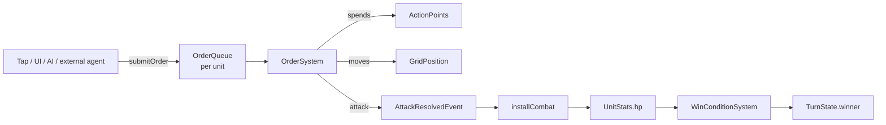
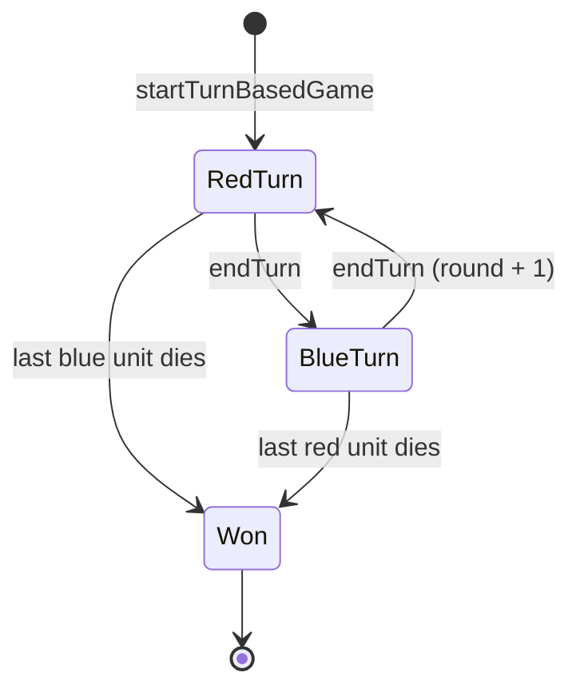

# Turn-based strategy

How the strategy layer works: the data, the rules, and the order things
happen in. If you would rather build first and read later, jump to
[Tutorial 2](../tutorials/02-turn-based-strategy.md).

!!! info "Where the code lives"
    Data and rules: `packages/engine_core/lib/src/turn/` (pure Dart).
    Tap input and selection markers: `packages/engine_flutter`
    (`GridTapController`, `SelectionMarkerSystem`).
    One-call wiring: `packages/engine_strategy`
    (`installStrategySystems`, `spawnStrategyUnit`).

## The mental model

A strategy game here is **a grid, some teams, and a queue of orders**.



Everything that changes the game goes through the same two doors:
**`submitOrder`** (intent) and **`endTurn`** (pass). A human's tap, the
built-in AI and an LLM-backed agent are indistinguishable to the engine, so
none of them can do anything a player couldn't.

## Data

| Component | JSON | Purpose |
|---|---|---|
| `Team` | `{"id": "red"}` | Which side an entity is on. Plain string, so levels can invent teams. |
| `GridPosition` | `{"col": 3, "row": 5}` | Cell the unit stands in. The source of truth for rules. |
| `Position` | `{"x": 168, "y": 264}` | World pixels, **derived** from the grid by `GridToWorldSystem` for rendering. |
| `ActionPoints` | `{"current": 2, "max": 4}` | Budget for the active turn. |
| `UnitStats` | `{"hp": 8, "maxHp": 10, "attack": 3, "defense": 1}` | Combat numbers. |
| `Vision` | `{"range": 4}` | Sight radius in cells. |
| `OrderQueue` | `{"orders": [{"type":"move","col":3,"row":5}]}` | Pending orders. |
| `Selected` | `{}` | Marker: the local player has this unit selected. |
| `TurnState` | `{"order":["red","blue"],"activeIndex":0,"round":1,"eliminated":[],"winner":null}` | The turn clock. One per world. |
| `FogOfWar` | `{"cols":8,"rows":8,"visible":{…},"explored":{…}}` | Per-team visibility. One per world, optional. |

All of these are listed with types and limits in the
[component reference](../reference/components.md).

## The turn clock



- `startTurnBasedGame(world, ['red', 'blue'])` creates the clock and **refills
  the first team's action points** — so spawn units first.
- `endTurn(world)` emits `TurnEndedEvent`, moves to the next team (skipping
  eliminated ones), increments `round` on wrap-around, refills that team's
  points and emits `TurnStartedEvent`.
- After a winner is set, `endTurn`, `submitOrder` and
  `trySpendActionPoints` all refuse.

### Action points

Every cost goes through one gate:

```dart
bool ok = trySpendActionPoints(world, unit, 2);
```

It fails — changing nothing — if it is not that unit's team's turn, the unit
has no `ActionPoints`, or it can't afford the cost. Because *everything*
spends this way, "can't act out of turn" is enforced in exactly one place.

## Orders

| Order | JSON | Behaviour |
|---|---|---|
| `MoveOrder(col, row)` | `{"type":"move","col":3,"row":5}` | Walks step by step, paying each cell's terrain cost. |
| `AttackOrder(target)` | `{"type":"attack","target":17}` | Walks into range if needed (with the navigator), then attacks. |

An order the unit **can't afford yet stays queued** and resumes next turn.
An order that **can never succeed** is dropped and an `OrderFailedEvent`
fires with a reason:

| `OrderFailure` | Meaning |
|---|---|
| `blocked` | No path (units or walls in the way). |
| `outOfRange` | Target too far (only without `approachTargets`). |
| `invalidTarget` | Target dead, friendly, missing, or hidden by fog. |

## Movement and terrain

`GridNavigator` is the rulebook for the grid:

```dart
final nav = GridNavigator(
  cols: 8, rows: 8,
  terrainCost: (col, row) => 1,   // return null for impassable
  diagonals: true,                // 8-way; never cuts a wall corner
);
nav.findPath(from, to);               // cheapest path, or null
nav.reachable(from, 4);               // every cell within 4 cost → for overlays
GridNavigator.fromTileMap(map, terrainCosts: {2: 3});   // forest = 3
```

- Diagonals cost the destination cell's cost.
- A diagonal is refused if either neighbouring cell is **wall terrain**, so
  units don't slip through corners. A *unit* beside the corner doesn't block
  it.
- Other units block the path (`blocked:` callback) but not diagonal corners.

## Combat

`installCombat(world)` listens for `AttackResolvedEvent` and applies

```
damage = max(1, attacker.attack − target.defense)
```

(never below 1, so fights can't deadlock on stats), then emits
`UnitDamagedEvent`, and on 0 hp `UnitDefeatedEvent` and destroys the unit.
There is **no friendly fire**: attack orders against your own team fail with
`invalidTarget`.

`WinConditionSystem` eliminates a team once it has no units left and sets
`TurnState.winner` when exactly one team remains (emitting `VictoryEvent`).
A team is only judged after it has been seen with units, so a unit-less
neutral side doesn't end the game on tick one.

## Fog of war

Optional. `installStrategySystems(fog: true, blocksSight: …)` adds a
`FogOfWar` and `VisionSystem`.

- A cell is **visible** to a team if a unit's `Vision` circle reaches it and
  a Bresenham line to it crosses no `blocksSight` cell. The line's endpoints
  never block, so you can always see the wall you are looking at.
- `visible` is recomputed each tick; `explored` only grows.
- `blocksSight` is separate from terrain cost on purpose — you can see across
  a lake you can't walk over.
- `canSee(world, team, entity)` is true for your own units and for enemies on
  visible cells. **Attack orders on unseen enemies fail, and
  `AggressiveAI` obeys the same rule.**

## Selection and input

Pure functions in the core:

| Function | Does |
|---|---|
| `selectAtCell(world, col, row, additive:)` | Select the active team's unit in a cell. |
| `selectInBox(world, c0, r0, c1, r1, additive:)` | Box select (corners in any order). |
| `commandSelected(world, col, row, replace:)` | Move to a free cell / attack an enemy there. |
| `clearSelection(world)` | Deselect all. |

and one Flutter helper that maps pixels to those calls:

```dart
final taps = GridTapController(48);          // cell size in pixels
taps.handleTap(world, worldPosition);        // → selected | commanded | ignored
taps.handleDrag(world, start, end);          // box select
```

## AI opponents

```dart
abstract class TurnAI { void playTurn(World world, String team); }
```

`AITurnSystem` runs a team's `TurnAI` **once at the start of its turn**,
lets `OrderSystem` execute what it queued, and ends the turn when no queued
order can still progress (the rest are waiting on points that arrive next
turn). `AggressiveAI` sends every idle unit after the nearest enemy its team
can see. Writing your own is a ten-line class —
[recipe](../examples/custom-turn-ai.md).

## System order

`installStrategySystems` registers, in this order:

| # | System | Why here |
|---|---|---|
| 1 | `vision` *(fog only)* | Visibility must be current before attacks are checked. |
| 2 | `orders` | Executes queued orders, spending points. |
| 3 | `aiTurn` *(AI only)* | After orders, so "nothing left affordable" sees this tick's results. |
| 4 | `turn` | Auto-ends teams listed in `autoEndTeams`. |
| 5 | `winCondition` | Judges eliminations after this tick's kills. |
| 6 | `gridToWorld` | Syncs pixels from the final cells. |
| 7 | `selectionMarkers` | Follows the synced pixels. |

Reordering these changes behaviour; add your own systems around them rather
than between.

## Events

| Event | Fired when |
|---|---|
| `TurnStartedEvent(team, round)` | A team's turn begins, points refilled. |
| `TurnEndedEvent(team, round)` | A team's turn ends. |
| `MovedEvent(entity, col, row)` | A unit enters a cell (one per step). |
| `AttackResolvedEvent(attacker, target)` | An attack lands (before damage). |
| `UnitDamagedEvent(attacker, target, amount)` | Damage applied. |
| `UnitDefeatedEvent(unit, team)` | A unit reaches 0 hp, just before destruction. |
| `OrderFailedEvent(entity, order, reason)` | An order was dropped. |
| `VictoryEvent(team)` | One team remains. |

## Design decisions

- **Teams are strings**, not an enum — levels and agents can add sides without
  an engine change.
- **The grid is the truth, pixels are derived.** Mixing the two invites
  off-by-half-a-cell bugs.
- **Points refill at turn *start*,** so the budget an agent reads during the
  opponent's turn is the one it will really have.
- **`UnitStats`, not `Health`.** The platformer's `Health` lives later in the
  dependency chain, which a strategy package can't depend on.
- **No wall-clock time anywhere in the rules.** A game is a function of its
  orders, so it replays and tests deterministically.

## Not built yet

Real-time strategy (needs a fixed-step accumulator for lockstep, flow-field
pathfinding for large groups) and smarter AI (flanking, objectives).
See [the roadmap](https://github.com/arashrasoulzadeh/agentic-game-engine/blob/main/TODO.md#turn-based-strategy).
