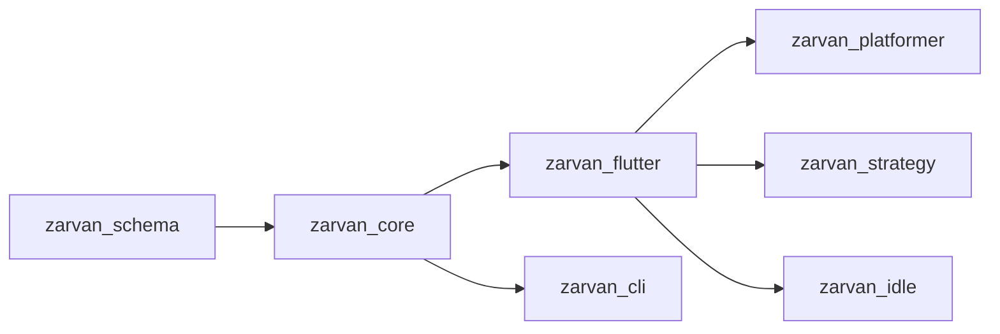

# معماری

بسته‌ها چگونه کنار هم قرار می‌گیرند و در هر فریم چه می‌گذرد.

## زنجیره‌ی وابستگی

وابستگی‌ها یک‌طرفه‌اند: هر بسته می‌تواند از بسته‌های سمت چپ خود استفاده کند، هرگز از سمت راست.

قاعده: **داده‌ی عمومی ژانر در `zarvan_core` می‌ماند حتی اگر فقط یک ژانر امروز از آن استفاده کند؛ فقط منطق مخصوص ژانر به راست می‌رود.**

## یک فریم

1. نمای Flutter مقدار `world.step(dt)` را صدا می‌زند (یک بار یا چند بار با گام ثابت).
2. هر system به ترتیب ثبت اجرا می‌شود و ممکن است رخداد (event) بفرستد.
3. رخدادها یک بار در هر گام، بعد از همه‌ی systemها، تحویل داده می‌شوند (flush).
4. رندر انجام می‌شود.

- systemها هرگز یکدیگر را صدا نمی‌زنند؛ فقط از طریق componentها و رخدادها ارتباط دارند.
- با `EngineView.fixedTimestepSeconds` (معمولاً `1 / 60`) شبیه‌سازی از نرخ نمایش جدا می‌شود و روی همه‌ی دستگاه‌ها یکسان رفتار می‌کند.

## صحنه و وضعیت

هر `Scene` یک `World` تازه دارد. با عوض‌شدن صحنه، جهان دور ریخته می‌شود؛ هرچه باید بماند (امتیاز، قفل‌ها) در `GameState` نگه‌داری می‌شود.

## کجا چه چیزی را بگذارم؟

| نیاز | جای آن |
|---|---|
| نوع تازه‌ای از داده روی موجودیت‌ها | یک کلاس component و ثبت آن |
| قانونی که هر گام اجرا شود | یک `System` |
| واکنش به یک اتفاق | handler روی `world.events` |
| تصمیم AI یا LLM | `Behavior` (بی‌درنگ) یا `TurnAI` (نوبتی) |
| محتوای طراح یا عامل | JSON با `Level.loadInto` |

مرجع کامل (انگلیسی): [Architecture](../concepts/architecture.md)
