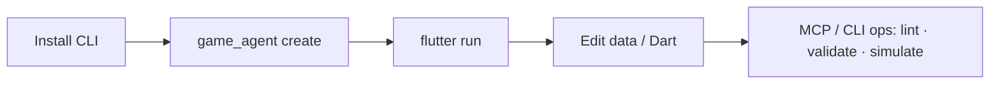

# Getting started

From nothing to a running game in about five minutes.



## Prerequisites

| Need | Version | Check |
|---|---|---|
| Flutter SDK (includes Dart) | Dart `^3.9.0` | `flutter --version` |
| Git | any recent | `git --version` |

Git matters because projects depend on the engine through a git dependency,
not pub.dev ([why](#why-a-git-dependency)).

## 1. Install the CLI

```bash
dart pub global activate --source git \
  https://github.com/arashrasoulzadeh/agentic-game-engine.git \
  --git-path packages/engine_cli
```

`game_agent` is now on your `PATH` (add `~/.pub-cache/bin` if the command
prints a warning).

## 2. Pick a starter and create it

=== "Platformer"

    ```bash
    game_agent create my_game
    ```

    A player, solid ground, patrol enemy, coin, health bar, keyboard and
    on-screen controls. Continue with [Tutorial 1](tutorials/01-hello-world.md).

=== "Turn-based strategy"

    ```bash
    game_agent create my_war --template strategy_game
    ```

    An 8×8 skirmish against an AI; map and units in
    `assets/levels/skirmish.level.json` (editable via `level.*` /
    `strategy.simulate_turns`). Continue with
    [Tutorial 2](tutorials/02-turn-based-strategy.md).

=== "Idle / incremental"

    ```bash
    game_agent create bakery --template idle_game
    ```

    Generators, upgrades, prestige, challenges, golden offers and offline
    catch-up — the economy is one JSON file. Continue with
    [Tutorial 5](tutorials/05-idle-game.md).

Then:

```bash
cd my_game          # or my_war / bakery
flutter run         # pick a device, or: flutter run -d chrome
```

## 3. What you got

```text
my_game/
├── lib/main.dart            Game subclass, first Scene, runGame()
├── assets/
│   ├── game_config.json     world size, orientation, background colour
│   └── levels/main.level.json   (platformer) the starting level, as data
├── test/widget_test.dart    boots the game and finds the EngineView
└── pubspec.yaml             engine packages as git dependencies
```

### The shape of `main.dart`

```dart
class MyGame extends Game {
  @override
  GameConfig get config => _config;            // loaded from game_config.json

  @override
  Scene createInitialScene() => MainScene();
}

class MainScene extends Scene {
  @override
  Future<void> populate(
    World world, SceneController scenes, GameState state,
  ) async {
    // Core + Flutter components are already registered by GameRunner.
    world.addSystem(MovementSystem());
    final player = world.spawn();
    world.storeOf<Position>().set(player, Position(100, 100));
    world.storeOf<Velocity>().set(player, Velocity(0, 0));
  }
}

void main() => runGame(MyGame());
```

| Piece | Role |
|---|---|
| `Game` | App-level config, input controller, first scene. |
| `Scene` | One screen. Owns a fresh `World`; `populate` fills it, `loadAssets` loads sprites, `handleTap` receives taps. |
| `GameState` | Survives scene switches (score, unlocks). |
| `runGame` | Starts the Flutter shell. |

New to `World`, `spawn` and `storeOf`? Read the [ECS guide](concepts/ecs.md).

## 4. Keep going

| Next | Why |
|---|---|
| [Tutorials](tutorials/README.md) | Build a platformer, a strategy game, or an agent-driven game. |
| [Tutorial 6 · Agent API](tutorials/06-agent-api.md) | MCP / REST / CLI: create → open → edit → validate → undo. |
| [Operations reference](reference/operations.md) | Every op (same on MCP, REST, JSON-RPC, CLI). |
| [Cheat sheet](reference/cheatsheet.md) | The calls you'll use most, on one page. |
| [FAQ](faq.md) | If something doesn't work. |

## Everyday commands

```bash
game_agent upgrade --ref main                     # move the engine pin forward
game_agent lint assets/levels/main.level.json     # validate a level (add --playable)
game_agent idle validate assets/idle_game.json    # idle definition check
game_agent strategy simulate-turns assets/levels/skirmish.level.json --turns 4
game_agent project open .                         # then project.problems / level.* / idle.*
game_agent pack-assets --input art --output-image assets/packed/atlas.png
```

See the [CLI reference](reference/cli.md) and [transports](reference/transports.md) for MCP/REST.

Published docs (when `engine.docs` has no local `docs/`):
<https://meetarash.ir/agentic-game-engine/> (`engine.capabilities` → `docsUrl`).

## Why a git dependency?

The packages aren't on pub.dev yet (pre-1.0). A generated project depends on
`engine_core`, `engine_flutter` and the genre package (`engine_platformer` or
`engine_strategy`) through a **self-referencing git dependency** — same repo
URL and `ref` for each — rather than local `path:` entries. Pub treats a
resolved commit and a consumer's `ref: main` as different descriptions of the
same package and refuses to solve if they're mixed; the self-referencing form
avoids that. Don't hand-edit these to `path:`; use `game_agent upgrade`.
Details: the "Non-obvious constraints" section of
[CLAUDE.md](https://github.com/arashrasoulzadeh/agentic-game-engine/blob/main/CLAUDE.md).

## Working on the engine itself

```bash
git clone https://github.com/arashrasoulzadeh/agentic-game-engine.git
cd agentic-game-engine
(cd packages/engine_core && dart test)
(cd packages/engine_flutter && flutter test)
```

See [CONTRIBUTING](https://github.com/arashrasoulzadeh/agentic-game-engine/blob/main/CONTRIBUTING.md).
