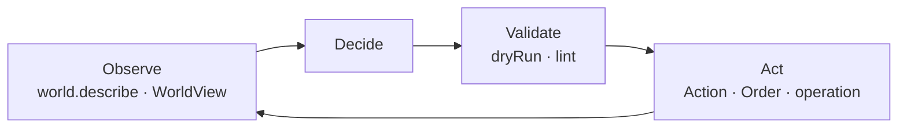

# For AI agents

This page is written for an AI agent (or for a developer building one) that
needs to **read** a ZARVAN world, **change** it, or **play** in it, safely.

## Machine-readable entry points

| Resource | Use |
|---|---|
| [`/llms.txt`](../llms.txt) | Index of every documentation page with a one-line description. |
| [Operations reference](../reference/operations.md) | Every operation, with the same name on CLI, MCP, REST and JSON-RPC. Generated from the registry, so always current. |
| [Components reference](../reference/components.md) | The exact JSON shape of every built-in component. Generated from `zarvan_schema`. |
| [Events](../reference/events.md) | Event types and when they fire. |
| `packages/*/lib/src/` | Every public symbol has a doc comment that says *why*. |

## Three ways to act, from safest to most direct

1. **As an entity's brain (real-time).** Implement a `Behavior`: it receives a
   read-only `WorldView` and returns an `Action`; `AISystem` applies it. You
   cannot corrupt state. See [The agent API](../concepts/agent-api.md).
2. **As a player (turn-based).** Read the world as JSON, submit `Order`s with
   `submitOrder`; the engine validates and applies them (fog of war applies).
   See [Turn-based strategy](../concepts/turn-based-strategy.md) and
   [Tutorial 3](../tutorials/03-agent-driven-game.md).
3. **As an author/operator.** Use operations over MCP, REST, JSON-RPC or the
   `zarvan` CLI: create a project, open it, edit levels, validate, undo. See
   [Tutorial 6](../tutorials/06-agent-api.md) and
   [Transports quick start](../reference/transports.md).

## Rules to follow

- **Never mutate stores from outside the system that owns the data.** Propose
  through `Action`, `Order`, patch or operation.
- **Read before you write:** `world.describe` / `world.query` operations,
  `World.toJson()`, or `WorldView`.
- **Validate before you run:** `zarvan lint`, `project.problems`,
  `World.checkPatch`, `applyPatch(strict: true, dryRun: true)`.
- **A component only serializes once registered.** If your data is missing from
  `toJson` or a patch, see [FAQ](../faq.md#my-component-isnt-saved-or-loaded).
- **Determinism:** use `world.random` and the fixed timestep; do not use
  wall-clock time or a global `Random` inside simulation code.
- **Use `--read-only`** on the CLI when you only need to observe.

## A typical agent loop

## Where to go next

[The agent API](../concepts/agent-api.md) · [Operations](../reference/operations.md)
· [Content as data](../concepts/content-as-data.md) · [Concept](../concepts/concept.md)
