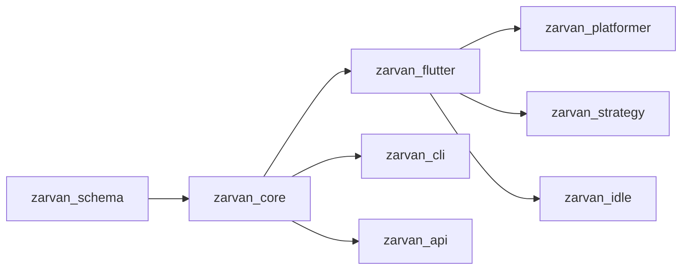

# Packages

ZARVAN is a set of small Dart/Flutter packages on a **one-way dependency
chain**: a package may use anything to its left, never anything to its right.

| Package | Audience | What it gives you | Runtime |
|---|---|---|---|
| [`zarvan_core`](https://github.com/arashrasoulzadeh/zarvan/tree/main/packages/zarvan_core) | Developers, agents | The engine: ECS, physics primitives, `TileMap`, content DSL, the `WorldView`/`Behavior` agent API, the turn-based rules (turn clock, orders, navigation, combat, fog of war), idle-game rules, and the operation registry. | Pure Dart, no Flutter |
| [`zarvan_schema`](https://github.com/arashrasoulzadeh/zarvan/tree/main/packages/zarvan_schema) | Tool builders, agents | Hand-written component schemas used by the CLI and Studio to validate content. | Pure Dart |
| [`zarvan_flutter`](https://github.com/arashrasoulzadeh/zarvan/tree/main/packages/zarvan_flutter) | Developers | The Flutter shell: `Game`/`Scene`, sprites, camera, lighting, input, audio, save/load. No gameplay logic. | Flutter |
| [`zarvan_platformer`](https://github.com/arashrasoulzadeh/zarvan/tree/main/packages/zarvan_platformer) | Developers | Gravity, jump, tile/platform collision, combat, patrol/follow AI, animation. | Flutter |
| [`zarvan_strategy`](https://github.com/arashrasoulzadeh/zarvan/tree/main/packages/zarvan_strategy) | Developers | One-call wiring for turn-based strategy and unit spawning. | Flutter |
| [`zarvan_idle`](https://github.com/arashrasoulzadeh/zarvan/tree/main/packages/zarvan_idle) | Developers, game makers | Idle/incremental games: widgets, controller, session, saving. | Flutter |
| [`zarvan_api`](https://github.com/arashrasoulzadeh/zarvan/tree/main/packages/zarvan_api) | Agents, operators | MCP server and HTTP / JSON-RPC API over the operation registry. | Pure Dart |
| [`zarvan_cli`](https://github.com/arashrasoulzadeh/zarvan/tree/main/packages/zarvan_cli) | Game makers, agents | The `zarvan` command: `create`, `upgrade`, `lint`, and every operation as a command. | Pure Dart |
| [`zarvan_studio`](https://github.com/arashrasoulzadeh/zarvan/tree/main/packages/zarvan_studio) | Game makers | The visual Studio for editing levels and content. | Flutter |

## Which one do I need?

| I am building… | Depend on |
|---|---|
| A headless simulation or test harness | `zarvan_core` |
| A platformer | `zarvan_platformer` (brings core and flutter) |
| A turn-based strategy game | `zarvan_strategy` |
| An idle game | `zarvan_idle` |
| A tool or agent that drives worlds | `zarvan_api` or the `zarvan` CLI |

Not published to pub.dev yet (pre-1.0): generated projects depend on the
packages through a self-referencing git dependency. See
[Getting started](getting-started.md#why-a-git-dependency).
