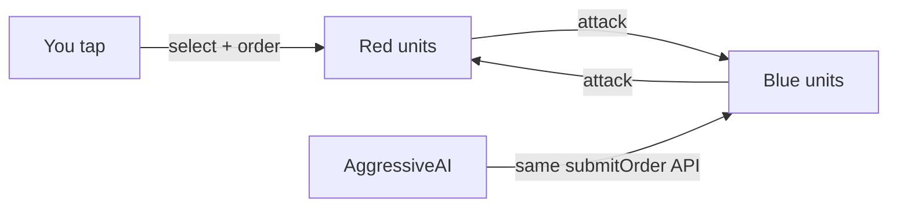

# Tutorial 2: a turn-based strategy skirmish

**You will build:** an 8×8 battlefield where you command two red units
against a computer-controlled blue army, with terrain that slows movement,
fog of war, and a victory message.

**Time:** about 30 minutes. **Prerequisite:** [Getting started](../getting-started.md).
Background reading, if you want it:
[Turn-based strategy concepts](../concepts/turn-based-strategy.md).

!!! tip "Skip the typing"
    `game_agent create my_war --template strategy_game` generates steps 1–5
    and 7 already assembled. This tutorial shows what's inside so you can
    change it.

Every code block below is executed by
`packages/engine_strategy/test/doc_examples_test.dart`, so what you read is
what runs.

## What you are making



## Step 1 — a world and a grid

The *grid* is a `GridNavigator`: how big the board is and what it costs to
enter each cell. Start with every cell costing 1.

```dart
final world = World(width: 384, height: 384);
registerCoreComponents(world);
registerFlutterComponents(world);   // GameRunner does both for you inside a Scene

const cell = 48.0;                  // pixels per grid cell
final nav = GridNavigator(cols: 8, rows: 8, terrainCost: (col, row) => 1);
```

`terrainCost` returns the action points needed to *enter* a cell, or `null`
for a wall.

## Step 2 — install the systems

```dart
installStrategySystems(world, navigator: nav, cellSize: cell);
```

One call registers orders, turn handling, win detection, grid-to-pixel sync,
selection markers and combat, **in the order that works**. Printing
`world.systemOrder` shows
`[orders, turn, winCondition, gridToWorld, selectionMarkers]`.

## Step 3 — spawn two armies

```dart
final knight = spawnStrategyUnit(world,
    team: 'red', col: 1, row: 6, cellSize: cell,
    maxHp: 12, attack: 5, actionPoints: 4);
final archer = spawnStrategyUnit(world,
    team: 'red', col: 2, row: 6, cellSize: cell,
    attack: 3, actionPoints: 3);
final goblin = spawnStrategyUnit(world,
    team: 'blue', col: 5, row: 2, cellSize: cell,
    maxHp: 8, attack: 2);
```

`spawnStrategyUnit` attaches `Team`, `GridPosition`, `Position`,
`ActionPoints`, `UnitStats` (and `Vision` / `Sprite` if you pass
`visionRange` / `atlasId` + `spriteRegion`). Defaults: 10 hp, 3 attack,
0 defense, 3 action points.

| Unit | Team | Cell | HP | Attack | Points |
|---|---|---|---|---|---|
| knight | red | (1, 6) | 12 | 5 | 4 |
| archer | red | (2, 6) | 10 | 3 | 3 |
| goblin | blue | (5, 2) | 8 | 2 | 3 |

## Step 4 — start the clock

```dart
startTurnBasedGame(world, ['red', 'blue']);
```

!!! warning "Spawn first, then start"
    Starting the clock refills the first team's action points. A unit spawned
    afterwards begins with 0 points and can't act until its team's next turn.

Red moves first. `turnStateOf(world)!.activeTeam` is `'red'` and the knight
has 4 points.

## Step 5 — taps become orders

`GridTapController` turns a world-space tap into the right call:

```dart
final taps = GridTapController(cell);

taps.handleTap(world, const Offset(1.5 * cell, 6.5 * cell)); // tap the knight → selected
taps.handleTap(world, const Offset(1.5 * cell, 4.5 * cell)); // tap an empty cell → move order
world.step(1 / 60);                                          // the order executes
```

The knight walks two cells north, paying 1 point per cell, so it has 2 left.

Tapping an **enemy** issues an attack. The unit first walks into range:

```dart
taps.handleTap(world, const Offset(5.5 * cell, 2.5 * cell)); // tap the goblin
```

In a real game, put this in your scene:

```dart
@override
void handleTap(World world, SceneController scenes, Offset worldPosition) {
  taps.handleTap(world, worldPosition);
}
```

and give the player a way to pass the turn — the template uses a strip below
the grid:

```dart
if (worldPosition.dy >= 8 * cell) endTurn(world);
```

## Step 6 — terrain

Make some cells slow and some impassable using a `TileMap`:

```dart
const forest = 2, mountain = 3;
final map = TileMap(
  cols: 5, rows: 1, tileWidth: 48, tileHeight: 48,
  tiles: [0, forest, forest, mountain, 0],
  solidTileIds: {mountain},
);
final nav = GridNavigator.fromTileMap(map, terrainCosts: {forest: 3});
```

| Tile | Cost |
|---|---|
| `0` grass | 1 |
| `2` forest | 3 |
| `3` mountain | impassable |

Show the player where a unit can go with `reachable`:

```dart
final reach = nav.reachable(GridPosition(0, 0), 4);   // Map<(col,row), cost>
reach[(1, 0)];                                        // 3 — one forest cell
reach.containsKey((2, 0));                            // false — 3 + 3 > 4
```

Draw those cells as translucent rectangles: see
[Move-range overlay](../examples/move-range-overlay.md).

## Step 7 — an opponent

Pass a `TurnAI` for each computer-controlled team:

```dart
installStrategySystems(
  world,
  navigator: nav,
  cellSize: cell,
  aiTeams: {'blue': AggressiveAI()},
);
```

When blue's turn starts, `AggressiveAI` orders every unit that has action
points to attack the nearest enemy blue can see. The engine executes the
orders, then ends the turn by itself once nothing queued is affordable.

## Step 8 — react to what happens

Events are how your UI, sounds and score keep up. Subscribe once:

```dart
final log = <String>[];
world.events.on<UnitDamagedEvent>((e) => log.add('hit ${e.target} for ${e.amount}'));
world.events.on<VictoryEvent>((e) => log.add('${e.team} wins'));
```

| Event | Use it for |
|---|---|
| `TurnStartedEvent` | "Your move" banner, clearing selection |
| `MovedEvent` | Footstep sounds |
| `UnitDamagedEvent` | Damage numbers, hit flash |
| `UnitDefeatedEvent` | Death animation |
| `VictoryEvent` | End screen |

## Step 9 — play a whole game headlessly

Because rules don't depend on Flutter, you can run the entire game in a test
or a script. Here red's hero attacks every round and blue's AI answers:

```dart
for (var round = 0; round < 10 && turnStateOf(world)!.winner == null; round++) {
  submitOrder(world, hero, AttackOrder(orc));
  world.step(1 / 60);                       // orders execute
  endTurn(world);
  for (var i = 0; i < 4; i++) {
    world.step(1 / 60);                     // AI plans, acts, hands the turn back
  }
}
// turnStateOf(world)!.winner == 'red'
```

## Step 10 — fog of war

```dart
final walls = {(4, 3)};
installStrategySystems(
  world,
  navigator: nav,
  cellSize: cell,
  fog: true,
  blocksSight: (col, row) => walls.contains((col, row)),
);
spawnStrategyUnit(world, team: 'red', col: 2, row: 3, cellSize: cell, visionRange: 4);
```

Now enemies behind the wall at (4, 3) are invisible to red, and so are
attacks against them. See the [fog recipe](../examples/fog-of-war.md).

## Checkpoint: what you should see

- Tapping a red unit shows a cyan bar under it.
- Tapping a free cell moves it, spending one point per step.
- Tapping a blue unit walks over and hits it for `attack − defense`.
- Passing the turn makes blue move toward you and attack.
- The last unit of a team dying shows the victory message and freezes input.

## Where to go next

- Write your own opponent: [Custom TurnAI](../examples/custom-turn-ai.md).
- Let an LLM or script play: [Tutorial 3](03-agent-driven-game.md).
- Persist a game: [Save and restore](../examples/save-restore-turn-game.md).
- Everything in one place: [Cheat sheet](../reference/cheatsheet.md).
