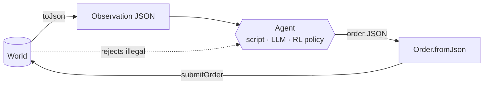

# Tutorial 3: an agent-driven game

**You will build:** a program that plays a full turn-based game seeing
**nothing but JSON** and acting **only by submitting JSON orders** — the exact
contract an LLM, a remote bot, or a test harness would use. It then beats the
built-in AI.

**Prerequisite:** the [turn-based concepts](../concepts/turn-based-strategy.md)
page (or [Tutorial 2](02-turn-based-strategy.md)). No Flutter needed — this
tutorial is pure Dart.

The code is executed by
`packages/engine_core/test/agent_turn_based_test.dart`.

## Why this matters



The engine is the referee. The agent can be wrong, malicious or confused and
the worst outcome is a rejected order — it can't change a hit point directly.

## Step 1 — build a headless game

No `Game`, no `Scene`, no rendering:

```dart
World buildGame() {
  final world = World(width: 8, height: 8);
  registerCoreComponents(world);
  final nav = GridNavigator(cols: 8, rows: 8, terrainCost: (c, r) => 1);
  world.addSystem(OrderSystem.withNavigator(nav));
  world.addSystem(AITurnSystem({'blue': AggressiveAI()}));
  world.addSystem(WinConditionSystem());
  installCombat(world);

  EntityId unit(String team, int col, int row, {int hp = 10, int attack = 4}) {
    final id = world.spawn();
    world.storeOf<Team>().set(id, Team(team));
    world.storeOf<GridPosition>().set(id, GridPosition(col, row));
    world.storeOf<ActionPoints>().set(id, ActionPoints(4, current: 0));
    world.storeOf<UnitStats>().set(id, UnitStats(maxHp: hp, attack: attack));
    return id;
  }

  unit('red', 0, 0, hp: 14, attack: 5);
  unit('red', 0, 1);
  unit('blue', 6, 6, hp: 8);
  unit('blue', 7, 6, hp: 8);
  startTurnBasedGame(world, ['red', 'blue']);
  return world;
}
```

(`installStrategySystems` does the same wiring in one call; spelled out here
so you can see there's nothing hidden.)

## Step 2 — observe

The agent's whole view of the world is `World.toJson()`. Reduce it to what
the policy needs:

```dart
Map<String, dynamic> observe(World world, String me) {
  final snapshot = world.toJson();
  final units = <Map<String, dynamic>>[];
  for (final e in snapshot['entities'] as List) {
    final c = (e['components'] as Map).cast<String, dynamic>();
    if (!c.containsKey('unitStats')) continue;
    units.add({
      'id': e['id'],
      'team': c['team']['id'],
      'col': c['gridPosition']['col'],
      'row': c['gridPosition']['row'],
      'hp': c['unitStats']['hp'],
      'ap': c['actionPoints']['current'],
    });
  }
  final turn = (snapshot['entities'] as List)
      .map((e) => (e['components'] as Map)['turnState'])
      .firstWhere((t) => t != null) as Map;
  return {'active': turn['order'][turn['activeIndex']], 'winner': turn['winner'], 'units': units};
}
```

A snapshot of one unit inside `toJson()` looks like this (shapes are listed in
the [component reference](../reference/components.md)):

```json
{
  "id": 0,
  "components": {
    "team": {"id": "red"},
    "gridPosition": {"col": 0, "row": 0},
    "actionPoints": {"current": 4, "max": 4},
    "unitStats": {"hp": 14, "maxHp": 14, "attack": 5, "defense": 0}
  }
}
```

The observation is plain JSON: it survives `jsonEncode` / `jsonDecode`
unchanged, so the same function works across a process or network boundary.

## Step 3 — decide

A policy is just `observation → orders`. This one sends every ready unit at
the weakest enemy:

```dart
List<Map<String, dynamic>> decide(Map<String, dynamic> view, String me) {
  final units = (view['units'] as List).cast<Map<String, dynamic>>();
  final enemies = units.where((u) => u['team'] != me).toList()
    ..sort((a, b) => (a['hp'] as int).compareTo(b['hp'] as int));
  if (enemies.isEmpty) return [];
  return [
    for (final u in units.where((u) => u['team'] == me && (u['ap'] as int) > 0))
      {'unit': u['id'], 'order': {'type': 'attack', 'target': enemies.first['id']}},
  ];
}
```

Swap this function for a call to a language model: give it `view` and the
[order schema](#the-order-format) below, and parse its reply into the same
list.

## Step 4 — act

```dart
final accepted = submitOrder(
  world,
  move['unit'] as int,
  Order.fromJson((move['order'] as Map).cast<String, dynamic>()),
);
```

`submitOrder` returns `false` (and does nothing) if it isn't that unit's
team's turn. `Order.fromJson` throws `FormatException` on an unknown order
type — a malformed order never reaches the world.

## Step 5 — the game loop

```dart
final world = buildGame();
for (var round = 0; round < 12; round++) {
  final view = observe(world, 'red');
  if (view['winner'] != null) break;

  for (final move in decide(view, 'red')) {
    submitOrder(world, move['unit'] as int,
        Order.fromJson((move['order'] as Map).cast<String, dynamic>()));
  }
  world.step(1 / 60);           // orders execute
  endTurn(world);               // pass
  for (var i = 0; i < 4; i++) {
    world.step(1 / 60);         // blue's AI plays and returns the turn
  }
}
// observe(world, 'red')['winner'] == 'red'
```

## The order format

| `type` | Fields | Example |
|---|---|---|
| `move` | `col`, `row` | `{"type":"move","col":3,"row":5}` |
| `attack` | `target` (entity id) | `{"type":"attack","target":17}` |

Orders are submitted for a specific unit id; both arguments are plain data.

## Making it fair: fog of war

If the agent should see what a human would, give it
`FogOfWar` data instead of the full snapshot — `visible` for the agent's team
is already in `toJson()`. The built-in AI uses `canSee` for the same
reason. Attack orders against unseen units fail either way, so a cheating
agent gains nothing from peeking.

## Making it reproducible

- The rules contain no randomness and no wall-clock time; a game is a
  function of its orders. Record the order stream and you have a replay.
- If your policy uses randomness, use
  `DeterministicRandom(seed)` so runs can be repeated.

## Beyond turn-based: real-time agents

For real-time games (platformers) the same idea applies with a different door:
a `Behavior` receives a read-only `WorldView` and returns an `Action`. See
[the agent API](../concepts/agent-api.md) and the
[custom Behavior recipe](../examples/custom-behavior.md).

## Checkpoint

- You can describe the agent's whole interface in two sentences.
- Replacing `decide` with something smarter changes no other code.
- Trying to order a blue unit during red's turn returns `false`.
