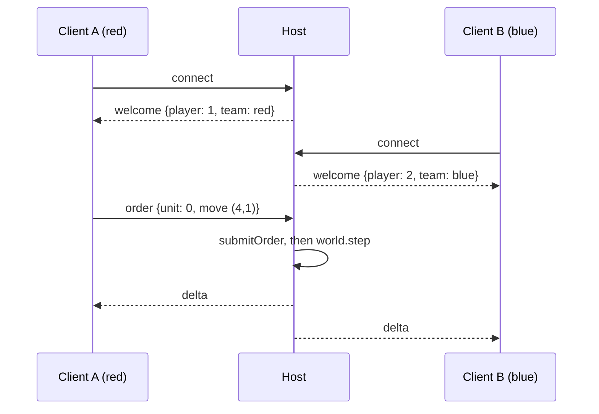

# Tutorial 4: a two-player game over the network

**You will build:** a host process that runs the game and two clients that connect to
it over WebSockets, each controlling their own team. Pure Dart — no Flutter needed
for the networking, so you can run all three in terminals.

**Prerequisites:** [Tutorial 2](02-turn-based-strategy.md) (the game) and the
[networking concepts](../concepts/networking.md). The code below is exercised by
`packages/engine_core/test/websocket_transport_test.dart`.

## What runs where



## Step 1 — the host

```dart
import 'dart:async';

import 'package:engine_core/engine_core.dart';
import 'package:engine_core/engine_core_io.dart';

Future<void> main() async {
  final world = World(width: 12, height: 12);
  registerCoreComponents(world);
  world.addSystem(OrderSystem.withNavigator(
      GridNavigator(cols: 12, rows: 12, terrainCost: (c, r) => 1)));
  installCombat(world);

  // Two armies (spawn them however you like - Tutorial 2 shows spawnStrategyUnit).
  for (var i = 0; i < 3; i++) {
    for (final (team, col) in [('red', 1), ('blue', 10)]) {
      final e = world.spawn();
      world.storeOf<Team>().set(e, Team(team));
      world.storeOf<ActionPoints>().set(e, ActionPoints(6, current: 0));
      world.storeOf<GridPosition>().set(e, GridPosition(col, 3 + i));
      world.storeOf<UnitStats>().set(e, UnitStats(maxHp: 10, attack: 3));
    }
  }
  startTurnBasedGame(world, ['red', 'blue']);

  final host = HostSession(world: world, teams: ['red', 'blue']);
  final server = await WebSocketListener.bind(host.accept, port: 4040);
  print('listening on ${server.localUrl}');

  Timer.periodic(const Duration(milliseconds: 50), (_) {
    world.step(0.05);
    host.afterStep();                 // replicate to everyone
  });
}
```

`WebSocketListener.bind(host.accept)` hands every new connection to the host, which
assigns the next free team. A third connection is told `full` and closed.

## Step 2 — a client

```dart
import 'package:engine_core/engine_core.dart';
import 'package:engine_core/engine_core_io.dart';

Future<void> main() async {
  final world = World(width: 12, height: 12);
  registerCoreComponents(world);             // same components as the host

  final endpoint = await connectWebSocket('ws://127.0.0.1:4040');
  final session = ClientSession(world: world, endpoint: endpoint);

  session.onWelcome = () => print('I am player ${session.playerId} on ${session.team}');
  session.onRejected = (unit, reason) => print('refused: $reason');

  // Wait for the first snapshot, then order one of our units.
  await Future<void>.delayed(const Duration(seconds: 1));
  final mine = [
    for (final e in world.entities.all)
      if (world.storeOf<Team>().get(e)?.id == session.team) e,
  ];
  session.sendOrder(mine.first, const MoveOrder(4, 3));
}
```

`world` here is a **mirror**: the session overwrites it with each snapshot/delta. Read
it to draw the game; never simulate it.

## Step 3 — try it

```bash
dart run host.dart          # terminal 1
dart run client.dart        # terminal 2 -> red
dart run client.dart        # terminal 3 -> blue
```

Expected output (these programs were run exactly as written):

```text
# terminal 1 (host)
listening on ws://127.0.0.1:4040
# terminal 2 (first client)
I am player 1 on red
# terminal 3 (second client)
I am player 2 on blue
refused: order not allowed now
```

The blue client's order is **refused** — it is red's turn, and the host enforces that
no matter what the client tries. Make blue wait for its turn (watch
`TurnState` in the mirror world, or `TurnStartedEvent`) and it goes through.

## What the host protects you from

Everything arrives as an *order*, and the host checks it:

| Client sends | Host replies |
|---|---|
| order for an enemy unit | `rejected: not your unit` |
| order for a unit that doesn't exist | `rejected: no such unit` |
| `{"type":"teleport"}` | `rejected: malformed order` |
| order during the other team's turn | `rejected: order not allowed now` |
| random bytes | dropped silently; the connection survives |

## Add latency measurement

```dart
final sw = Stopwatch()..start();
final session = ClientSession(
  world: world,
  endpoint: endpoint,
  clock: () => sw.elapsedMilliseconds,
);
Timer.periodic(const Duration(seconds: 2), (_) => session.ping());
// later: session.rttMs
```

## Where to go next

- Turn the mirror into something you can see: use `EngineView` with the mirrored
  world and `GridTapController(cell, localTeam: session.team)` for input — but send
  the resulting orders with `session.sendOrder` instead of `submitOrder`.
- Real-time? Add [prediction and rollback](../concepts/networking.md#prediction-and-rollback).
- Browser clients: implement `NetEndpoint` over `web_socket_channel`.

## Checkpoint

- Two terminals can play on opposite teams of one host.
- You can name three things a hostile client can't do.
- You know why the client's `World` has no systems.
