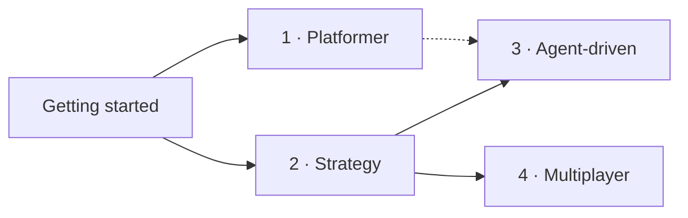

# Tutorials

Linear walkthroughs. Each ends with something that runs.

| # | Tutorial | You build | Time |
|---|---|---|---|
| 1 | [A tiny platformer](01-hello-world.md) | Player, ground, patrol enemy, coin, health bar | ~30 min |
| 2 | [Turn-based strategy](02-turn-based-strategy.md) | Grid skirmish vs an AI, with terrain and fog of war | ~30 min |
| 3 | [An agent-driven game](03-agent-driven-game.md) | A JSON-only agent that plays and beats the built-in AI | ~20 min |
| 4 | [Multiplayer](04-multiplayer.md) | A host and two WebSocket clients, each on their own team | ~25 min |

**New to the engine?** Do [Getting started](../getting-started.md) first, then
whichever of 1 or 2 matches your game. Do 3 if you want an AI agent, a bot or
an LLM to play or test your game.

